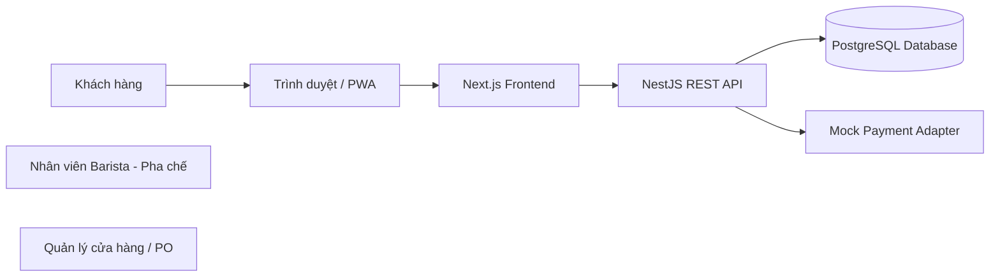
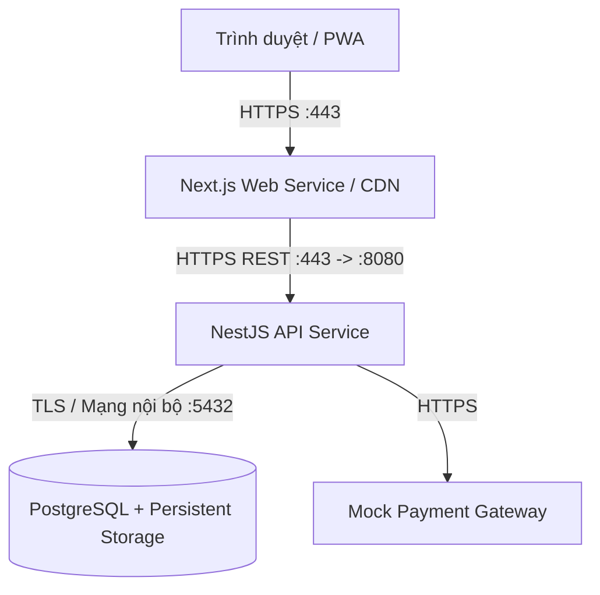

# BrewLite — Tổng quan kiến trúc hệ thống

> **Trạng thái:** Chính thức (Approved) — Toàn bộ các quyết định kiến trúc đã được nhóm thống nhất thông qua.

## 1. Mục đích và phạm vi

Tài liệu mô tả kiến trúc tổng quan chính thức của BrewLite — ứng dụng đặt cà phê không dùng tiền mặt, được phát triển trong khuôn khổ môn Công nghệ phần mềm (SGU).

**Phạm vi MVP:** Tập trung giải quyết trọn vẹn luồng nghiệp vụ cốt lõi dành cho Khách hàng (Customer) từ duyệt menu, tùy chọn thức uống, quản lý giỏ hàng, đặt đơn đến thanh toán không tiền mặt. Các chức năng nâng cao dành cho Nhân viên (Staff/Barista) và Quản trị viên (Admin) được thiết kế sẵn sàng để mở rộng ở các giai đoạn sau.

## 2. Bối cảnh công nghệ

- **Frontend:** Next.js, React, TypeScript, Tailwind CSS (Hỗ trợ PWA, Mobile-first).
- **Backend:** NestJS, TypeScript, REST API (Kiến trúc Modular Monolith).
- **Cơ sở dữ liệu:** PostgreSQL (kết hợp Prisma ORM và cơ chế migration tự động).
- **Repository:** Monorepo quản lý tập trung Frontend, Backend và Tài liệu (xem [ADR-001](adr/001-monorepo.md)).
- **Đóng gói & Triển khai:** Docker container, hỗ trợ triển khai trên các nền tảng PaaS (Render, Railway, Fly.io, Vercel).

## 3. Bối cảnh hệ thống

Trình duyệt hiển thị giao diện Frontend. Frontend gửi yêu cầu đến REST API. Backend kiểm tra dữ liệu, xác thực, phân quyền, áp dụng quy tắc nghiệp vụ và truy cập dữ liệu qua Prisma ORM.

**Mock Payment Adapter:** Là module xử lý thanh toán mô phỏng được phát triển độc lập cho đồ án, hỗ trợ Ví điện tử và Thẻ ngân hàng. Tuyệt đối không lưu trữ thông tin thẻ thanh toán nhạy cảm của người dùng.

## 4. Góc nhìn triển khai thành phần

Kiến trúc triển khai phân tách rõ ràng ranh giới mạng:
- Mọi kết nối từ Internet công cộng đều bắt buộc qua **HTTPS**.
- Cơ sở dữ liệu PostgreSQL nằm trong mạng nội bộ riêng (Private Network), không mở cổng ra Internet.
- Secret và biến môi trường được quản lý tập trung ở Secret Store của nhà cung cấp đám mây.

## 5. Định hướng Backend: Modular Monolith

Ứng dụng NestJS API được cấu trúc theo mô hình **Modular Monolith**, phân chia thành các module có ranh giới nghiệp vụ độc lập:

- **Auth / Identity Module:** Xác thực người dùng, băm mật khẩu (`bcrypt`), cấp phát và kiểm tra token JWT (`JwtAuthGuard`).
- **Users Module:** Quản lý hồ sơ người dùng, vai trò (`Role`) và tích lũy điểm thưởng (`loyaltyPoints`).
- **Products / Menu Module:** Quản lý danh mục đồ uống, tùy chọn size, topping, giá và số lượng tồn kho (`stock`).
- **Orders Module:** Quản lý quy trình đặt đơn, tính toán thành tiền ở phía server, kiểm soát đồng thời (Optimistic Locking) và máy trạng thái đơn hàng (xem [ADR-003](adr/003-state-machine.md)).
- **Payments Module:** Tích hợp cổng thanh toán mô phỏng, xử lý giao dịch an toàn với cơ chế chống lặp `Idempotency-Key`.
- **Common / Infrastructure Module:** Cung cấp `PrismaService` dùng chung, bộ lọc ngoại lệ toàn cục (`HttpExceptionFilter`), logging và endpoint kiểm tra tình trạng dịch vụ (`HealthCheckController`).

### Luồng xử lý yêu cầu chuẩn:
1. Client gửi yêu cầu REST API kèm Bearer JWT.
2. `JwtAuthGuard` và `ValidationPipe` thẩm định tính hợp lệ của token và dữ liệu đầu vào.
3. Controller định tuyến yêu cầu sang tầng Service nghiệp vụ.
4. Service áp dụng quy tắc kinh doanh, thực thi Database Transaction qua `PrismaService`.
5. API phản hồi kết quả thống nhất theo chuẩn REST JSON.

## 6. Tính toàn vẹn dữ liệu

- **Cơ sở dữ liệu:** PostgreSQL 16+ có cấu hình lưu trữ bền vững (Persistent Volume).
- **ORM & Migration:** Sử dụng **Prisma ORM** với quy trình migration tự động và có phiên bản rõ ràng (xem [ADR-002](adr/002-orm-selection.md)).
- **Database Transaction:** Áp dụng `prisma.$transaction()` cho toàn bộ luồng tạo đơn và thanh toán, bảo đảm tính toàn vẹn (ACID): tạo `Order`, các dòng `OrderItem` và cập nhật `stock` thành công trọn vẹn hoặc rollback toàn bộ khi có lỗi.
- **Optimistic Locking:** Sử dụng trường `version` trong bảng `Product` để ngăn chặn bán vượt số lượng tồn kho thực tế khi có nhiều yêu cầu đồng thời.

## 7. Các mối quan tâm xuyên suốt

### Bảo mật
- Kiểm tra dữ liệu đầu vào nghiêm ngặt bằng `class-validator` tại Backend.
- Phân quyền theo vai trò (Role-based Access Control - RBAC) ở mức API endpoint.
- Băm mật khẩu bằng `bcrypt` với salt rounds phù hợp, không lưu plain text.
- Phân tách biến môi trường công khai của Client (`NEXT_PUBLIC_API_URL`) và bí mật Backend (`DATABASE_URL`, `JWT_SECRET`).
- Không commit file `.env` lên Git; chỉ cung cấp tệp mẫu `.env.example`.

### Lỗi và Ghi log
- Bộ lọc lỗi toàn cục chuẩn hóa phản hồi JSON, tuyệt đối không để lộ stack trace hay thông tin máy chủ nội bộ.
- Ghi log có cấu trúc qua standard output (`stdout`/`stderr`), dễ dàng thu thập bởi Docker logging driver hoặc cloud monitor.
- Không log mật khẩu, token hoặc mã giao dịch nhạy cảm.

### Health Check và Quản lý Cấu hình
- Cung cấp endpoint `GET /health` để nhà cung cấp dịch vụ đám mây (PaaS) tự động kiểm tra tình trạng sống (liveness) và sẵn sàng (readiness).
- Tự động restart container khi gặp lỗi nghiêm trọng (Zero-downtime deployment).

## 8. Chất lượng và Đánh đổi (Trade-offs)

| Khía cạnh | Quyết định kỹ thuật | Ưu điểm đạt được | Đánh đổi / Biện pháp kiểm soát |
|---|---|---|---|
| **Cấu trúc Repo** | Monorepo (ADR-001) | Dễ đồng bộ API - UI, quy trình review tập trung | Cần thiết lập Branch protection và CI path filtering |
| **Kiến trúc App** | Modular Monolith | Đơn giản, dễ debug, triển khai nhanh, phù hợp quy mô MVP | Khả năng scale từng phần thấp hơn microservices; bù lại kiến trúc module hóa giúp dễ tách service sau này nếu cần |
| **ORM / Database** | Prisma ORM (ADR-002) | Type-safe tuyệt đối, schema trực quan, migration tự động | Cần chạy bước `prisma generate` và `prisma migrate` trong CI/CD build |
| **Vòng đời đơn** | State Machine (ADR-003) | Dữ liệu đơn hàng nhất quán, chống nhảy cóc trạng thái | Phải viết guard kiểm tra chặt chẽ ở mọi endpoint cập nhật đơn |
| **Thanh toán** | Mock Adapter + Idempotency | Không phụ thuộc ngân hàng thật, chống trừ tiền 2 lần khi rớt mạng | Cần duy trì bảng khóa `idempotency_keys` có thời hạn hết hạn (TTL) |

## 9. Danh mục Quyết định Kiến trúc (ADR)

Tất cả các quyết định kiến trúc đã được phê duyệt và lưu trữ chính thức:
- [ADR-001: Tổ chức Repository theo Monorepo](adr/001-monorepo.md) — **Accepted**
- [ADR-002: Lựa chọn lớp truy cập dữ liệu và ORM](adr/002-orm-selection.md) — **Accepted**
- [ADR-003: Quy định chuyển trạng thái đơn hàng](adr/003-state-machine.md) — **Accepted**

## 10. Trạng thái Đồng thuận của Nhóm

- [x] Đã thống nhất cấu trúc Monorepo và quy trình làm việc trên Git.
- [x] Đã chốt lựa chọn PostgreSQL và Prisma ORM cùng cơ chế tự động migration.
- [x] Đã phê duyệt mô hình Máy trạng thái 7 trạng thái cho vòng đời đơn hàng.
- [x] Đã xác định rõ luồng bảo mật, biến môi trường, health check và kiến trúc triển khai trên Docker/Cloud PaaS.
