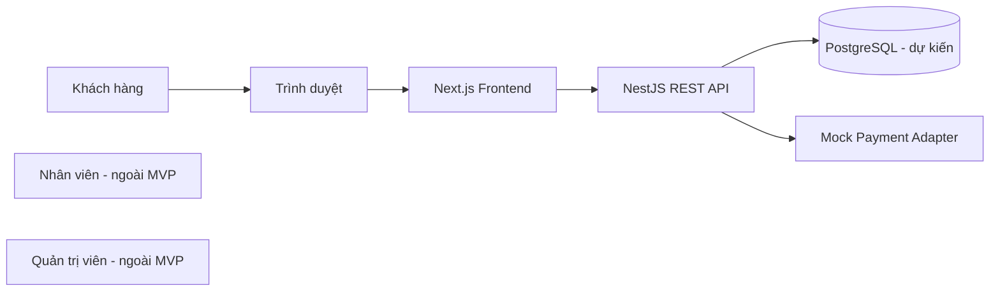
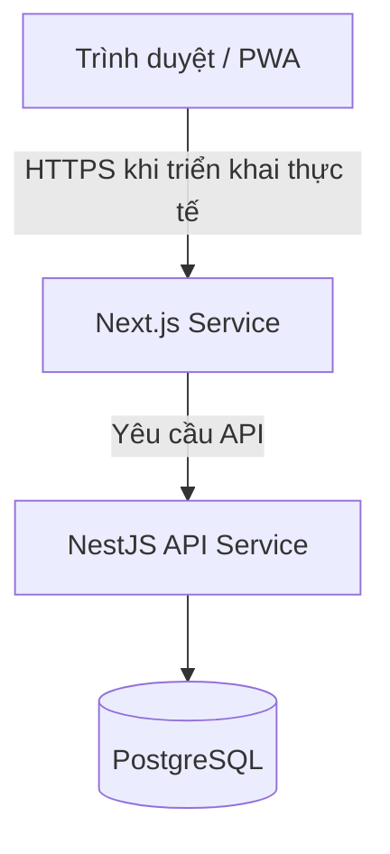

# BrewLite — Tổng quan kiến trúc hệ thống

> **Trạng thái:** Bản nháp, chờ nhóm xem xét. Cần đối chiếu với mã nguồn hiện tại và yêu cầu đã được thống nhất trước khi chốt.

## 1. Mục đích và phạm vi

Tài liệu mô tả kiến trúc tổng quan đề xuất của BrewLite — ứng dụng đặt cà phê không dùng tiền mặt, được phát triển trong khuôn khổ môn Công nghệ phần mềm.

**Phạm vi MVP:** Tập trung vào chức năng dành cho Khách hàng (Customer). Các chức năng dành cho Nhân viên (Staff) và Quản trị viên (Admin) nằm ngoài phạm vi MVP hiện tại.

## 2. Bối cảnh công nghệ

- **Frontend:** Next.js, React, TypeScript, Tailwind CSS.
- **Backend:** NestJS, TypeScript, REST API.
- **Cơ sở dữ liệu:** Dự kiến tích hợp PostgreSQL.
- **Repository:** Frontend, Backend và tài liệu được quản lý trong cùng một repository.
- **Đóng gói:** Docker thuộc bối cảnh thiết lập/yêu cầu dự án.

Cần kiểm tra nhánh mã nguồn và cấu hình hiện tại để phân biệt chức năng đã triển khai với chức năng còn dự kiến.

## 3. Bối cảnh hệ thống

Trình duyệt hiển thị giao diện Frontend. Frontend gửi yêu cầu đến REST API. Backend kiểm tra dữ liệu, xác thực, phân quyền, áp dụng quy tắc nghiệp vụ và truy cập dữ liệu.

**Mock Payment:** Là ranh giới xử lý thanh toán mô phỏng được đề xuất cho đồ án, không đại diện cho nhà cung cấp thanh toán thực tế. Không thu thập hoặc lưu trữ thông tin thẻ thanh toán.

## 4. Góc nhìn triển khai thành phần

Kiến trúc triển khai thực tế, cổng kết nối, TLS, quy tắc mạng, lưu trữ dữ liệu và quản lý bí mật cần được xác nhận theo kế hoạch triển khai. Không công khai cổng cơ sở dữ liệu ra Internet.

## 5. Định hướng Backend

### Đề xuất: Modular Monolith

Duy trì một ứng dụng NestJS API, được tổ chức thành các module có trách nhiệm rõ ràng. Đây là đề xuất chờ nhóm xác nhận, không khẳng định cấu trúc mã nguồn hiện tại đã hoàn thiện theo mô hình này.

Các ranh giới nghiệp vụ dự kiến:

- **Auth / Identity:** Xác thực và quản lý phiên hoặc token.
- **Users:** Hồ sơ người dùng và các chức năng liên quan đến vai trò.
- **Catalog / Menu:** Sản phẩm, danh mục và tình trạng kinh doanh.
- **Orders:** Tạo đơn hàng và quản lý vòng đời đơn.
- **Payments:** Xử lý thanh toán mô phỏng.
- **Common / Infrastructure:** Cấu hình, kiểm tra dữ liệu, ghi log, xử lý ngoại lệ và kiểm tra tình trạng dịch vụ.

Chỉ bổ sung module phù hợp với phạm vi đã được nhóm thống nhất.

### Luồng xử lý yêu cầu

1. Client gửi yêu cầu đến REST API.
2. API kiểm tra dữ liệu, xác thực và phân quyền khi cần.
3. Controller chuyển yêu cầu đến tầng xử lý nghiệp vụ.
4. Service áp dụng quy tắc và truy cập dữ liệu thông qua lớp dữ liệu được lựa chọn.
5. API trả về phản hồi hoặc lỗi theo định dạng thống nhất.

Giữ Controller gọn nhẹ, tránh lặp lại quy tắc nghiệp vụ ở Frontend.

## 6. Tính toàn vẹn dữ liệu

- PostgreSQL là cơ sở dữ liệu quan hệ dự kiến tích hợp.
- Sử dụng ràng buộc cơ sở dữ liệu kết hợp với kiểm tra dữ liệu phía máy chủ.
- Sử dụng transaction khi một nghiệp vụ cập nhật nhiều bản ghi liên quan, ví dụ đơn hàng và các dòng sản phẩm.
- Công nghệ ORM/lớp truy cập dữ liệu chưa được xác nhận; xem [ADR-002](adr/002-orm-selection.md).
- Quy tắc trạng thái đơn hàng cần được xác nhận; xem [ADR-003](adr/003-state-machine.md).

## 7. Các mối quan tâm xuyên suốt

### Bảo mật

- Kiểm tra dữ liệu đầu vào tại Backend.
- Thực hiện phân quyền tại các API.
- Sử dụng thuật toán/thư viện băm mật khẩu được duy trì và cấu hình phù hợp.
- Lưu bí mật trong cấu hình môi trường hoặc hệ thống quản lý bí mật, không đưa lên Git.
- Sử dụng HTTPS khi triển khai thực tế và cấp quyền dịch vụ theo nguyên tắc tối thiểu.
- Không lưu thông tin thẻ trong quy trình thanh toán mô phỏng.

### Lỗi và ghi log

- Trả về định dạng lỗi nhất quán, không để lộ stack trace hoặc thông tin nội bộ.
- Ghi nhận sự kiện vận hành cần thiết; sử dụng request ID/correlation ID khi phù hợp.
- Không ghi log mật khẩu, token hoặc thông tin thanh toán nhạy cảm.

### Kiểm tra tình trạng và cấu hình

- Xác định endpoint kiểm tra tình trạng hoạt động và mức độ sẵn sàng khi cần.
- Kiểm tra biến môi trường bắt buộc khi khởi động.
- Tách biệt cấu hình local, CI và production.
- Chỉ commit `.env.example` với giá trị mẫu, không commit bí mật thật.

## 8. Chất lượng và đánh đổi

| Mối quan tâm | Hướng xử lý đề xuất | Đánh đổi |
|---|---|---|
| Khả năng bảo trì | Module rõ trách nhiệm, Controller gọn | Cần kiểm soát phụ thuộc giữa module |
| Đơn giản | Một Backend deployment | Khả năng mở rộng độc lập thấp hơn microservices |
| Bảo mật | Kiểm tra dữ liệu, phân quyền, quản lý bí mật | Tăng công sức triển khai và review |
| Toàn vẹn | Ràng buộc và transaction phù hợp | Cần quản lý migration và transaction cẩn thận |
| Kiểm thử | Unit test cho Service và API integration test | Cần dữ liệu kiểm thử ổn định |
| Triển khai | Docker khi được cấu hình | Container không tự đảm bảo bảo mật/vận hành |

## 9. Danh mục ADR

- [ADR-001: Tổ chức Repository theo Monorepo](adr/001-monorepo.md)
- [ADR-002: Lựa chọn lớp truy cập dữ liệu / ORM](adr/002-orm-selection.md)
- [ADR-003: Quy định chuyển trạng thái đơn hàng](adr/003-state-machine.md)

## 10. Danh sách cần xác nhận

- [ ] Đối chiếu sơ đồ và module với repository hiện tại.
- [ ] Xác nhận tình trạng tích hợp PostgreSQL.
- [ ] Xác nhận ORM và quy trình migration.
- [ ] Xác nhận vòng đời đơn hàng và xử lý thanh toán mô phỏng.
- [ ] Xác nhận mô hình xác thực và phân quyền.
- [ ] Xác nhận health check, logging, biến môi trường và Docker.
- [ ] Nhận review của nhóm và cập nhật trạng thái tài liệu.
