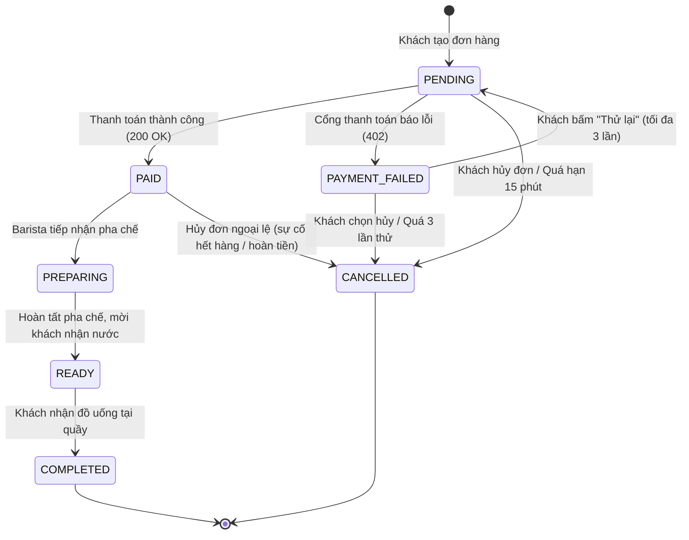

# ADR-003: Quy định chuyển trạng thái đơn hàng

- **Trạng thái:** Đã chấp thuận (Accepted)
- **Ngày:** 24-10-2026
- **Người quyết định:** Toàn bộ thành viên nhóm dự án BrewLite

## 1. Bối cảnh

Quy trình đặt và xử lý cà phê trực tuyến đòi hỏi vòng đời đơn hàng phải diễn ra theo một chu trình nghiêm ngặt, nhất quán giữa Frontend (Next.js), Backend (NestJS), Cổng thanh toán (Mock Payment) và Nghiệp vụ pha chế tại quầy (Barista).

Hệ thống cần tránh tuyệt đối các tình trạng dữ liệu không hợp lệ, ví dụ: đơn chưa thanh toán đã chuyển sang pha chế, đơn đã hoàn tất bị thanh toán lại, hoặc đơn bị hủy mà không hoàn trả tồn kho.

## 2. Quyết định

Nhóm thống nhất áp dụng mô hình **Máy trạng thái hữu hạn (Order State Machine)** gồm đúng **7 trạng thái** được kiểm soát tập trung tại tầng Backend NestJS. Mọi hành động chuyển trạng thái trái phép đều bị hệ thống chặn và phát sinh mã lỗi `400 Bad Request` hoặc `409 Conflict`.

## 3. Sơ đồ chuyển trạng thái chính thức

## 4. Định nghĩa và ý nghĩa các trạng thái

- **PENDING:** Đơn hàng vừa được khởi tạo từ giỏ hàng, đã giữ chỗ tồn kho và đang chờ thanh toán.
- **PAID:** Đã nhận phản hồi thanh toán thành công từ Mock Payment Gateway; điểm thưởng Loyalty được cộng cho khách.
- **PAYMENT_FAILED:** Giao dịch thanh toán bị từ chối; hệ thống giữ nguyên giỏ hàng để khách có thể thử lại.
- **PREPARING:** Nhân viên Barista tại quầy xác nhận tiếp nhận đơn và bắt đầu pha chế.
- **READY:** Đồ uống đã hoàn thành, hệ thống gửi thông báo mời khách tới quầy nhận nước.
- **COMPLETED:** Đơn hàng đã bàn giao thành công cho khách hàng (Trạng thái kết thúc thành công).
- **CANCELLED:** Đơn hàng bị hủy do khách chủ động, quá hạn thanh toán hoặc thanh toán lỗi quá số lần quy định (Trạng thái kết thúc đóng).

## 5. Quy tắc nghiệp vụ bắt buộc

1. **Kiểm soát từ Backend:** Toàn bộ logic chuyển trạng thái phải do hàm nghiệp vụ của Backend (ví dụ `assertTransition(currentStatus, targetStatus)`) kiểm tra và thực thi. Tuyệt đối không cho phép Frontend gửi trực tiếp trường `status` lên để ghi đè.
2. **Cơ chế Idempotency:** Mọi yêu cầu thanh toán đều phải kèm `Idempotency-Key` để tránh trường hợp mạng chập chờn gửi lặp làm chuyển trạng thái hoặc trừ tiền nhiều lần.
3. **Bảo toàn giỏ hàng khi lỗi:** Khi đơn chuyển sang `PAYMENT_FAILED`, hệ thống không trừ điểm tích lũy, không hủy giỏ hàng trên giao diện và cho phép khách thử lại tối đa 3 lần.
4. **Trạng thái bất biến (Immutable End-States):** Các đơn hàng đã ở trạng thái `COMPLETED` hoặc `CANCELLED` là trạng thái kết thúc, tuyệt đối không được phép chuyển sang bất kỳ trạng thái nào khác.

## 6. Hệ quả

### Lợi ích

- Thống nhất tuyệt đối hành vi của hệ thống giữa tài liệu SRS, Sơ đồ Use Case, Activity Diagram, Sequence Diagram và Class Diagram.
- Giúp việc viết Unit Test và Integration Test cho module Orders trở nên rõ ràng và bao phủ 100% các nhánh trạng thái.
- Dễ dàng mở rộng cho các tính năng nâng cao sau này (ví dụ: thông báo Webhook/SSE cho khách khi trạng thái chuyển sang `READY`).
