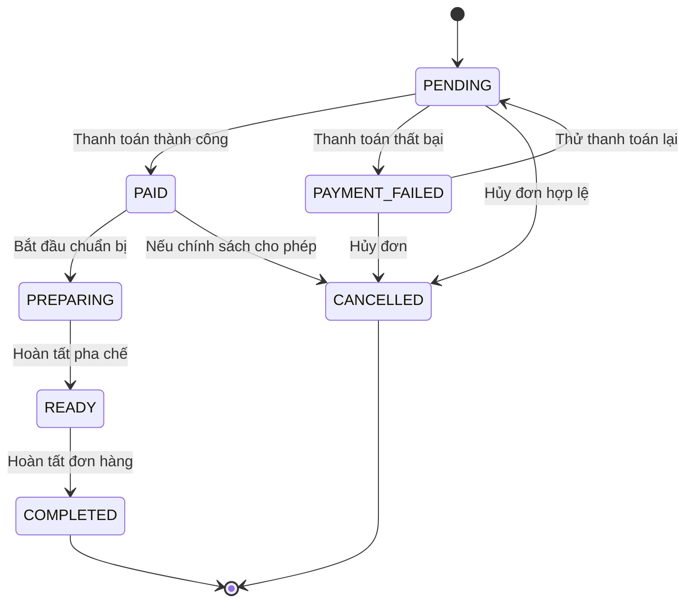

# ADR-003: Quy định chuyển trạng thái đơn hàng

- **Trạng thái:** Đề xuất, cần đối chiếu với yêu cầu dự án
- **Ngày:** 24-10-2026
- **Người quyết định:** Nhóm dự án

## 1. Bối cảnh

Quy trình đặt cà phê cần sử dụng trạng thái đơn hàng thống nhất giữa Backend, Frontend và các bài kiểm thử.

## 2. Quyết định đề xuất

Quản lý vòng đời đơn hàng bằng các trạng thái được định nghĩa rõ ràng. Backend chịu trách nhiệm kiểm tra và thực hiện các chuyển trạng thái hợp lệ. Không cho phép Client tự ý cập nhật trạng thái đơn hàng.

## 3. Sơ đồ chuyển trạng thái

## 4. Định nghĩa trạng thái

- **PENDING:** Đơn hàng được tạo và đang chờ thanh toán.
- **PAID:** Thanh toán thành công.
- **PAYMENT_FAILED:** Thanh toán thất bại; khách hàng có thể thử lại.
- **PREPARING:** Đơn hàng đang được chuẩn bị.
- **READY:** Đơn hàng đã sẵn sàng để nhận.
- **COMPLETED:** Đơn hàng đã hoàn tất.
- **CANCELLED:** Đơn hàng đã bị hủy.

## 5. Quy tắc nghiệp vụ

1. Đơn hàng mới được tạo với trạng thái `PENDING`.
2. Thanh toán thành công chuyển đơn sang `PAID`.
3. Thanh toán thất bại chuyển đơn sang `PAYMENT_FAILED`.
4. Khi thanh toán thất bại, không cộng điểm tích lũy và giữ nguyên giỏ hàng để khách có thể thử lại.
5. Khi thử lại thanh toán, đơn hàng có thể quay về `PENDING`.
6. Chỉ cho phép hủy đơn tại các trạng thái và thời điểm được chính sách nghiệp vụ quy định.
7. Sử dụng `Idempotency-Key` để hạn chế xử lý thanh toán trùng lặp.
8. Backend phải từ chối các chuyển trạng thái không hợp lệ.
9. Không cho phép thanh toán lại đơn đã ở trạng thái kết thúc như `COMPLETED` hoặc `CANCELLED`.
10. Không cộng điểm tích lũy trùng lặp khi xử lý lại yêu cầu thanh toán.

## 6. Hệ quả

### Lợi ích

- Thống nhất trạng thái giữa các thành phần.
- Dễ viết kiểm thử và xác định lỗi.
- Hạn chế cập nhật trạng thái trái phép.

### Rủi ro

- Cần xác định rõ quyền của từng vai trò.
- Chính sách hủy đơn sau thanh toán cần được nhóm xác nhận.
- Cần kiểm thử các trường hợp thử lại và yêu cầu trùng lặp.

## 7. Việc cần xác nhận

- [ ] Xác nhận sơ đồ trạng thái với yêu cầu đã duyệt.
- [ ] Xác nhận quyền thực hiện từng chuyển trạng thái.
- [ ] Xác nhận chính sách hủy sau thanh toán.
- [ ] Bổ sung kiểm thử chuyển trạng thái hợp lệ và không hợp lệ.
- [ ] Xác nhận cơ chế xử lý thanh toán lặp và thử lại.
