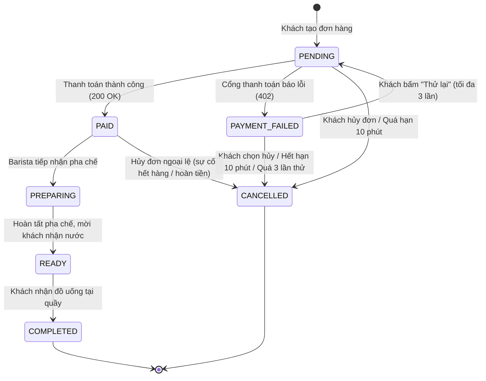

# ADR-003: Quy định chuyển trạng thái đơn hàng

- **Trạng thái:** Đã chấp thuận (Accepted)
- **Ngày:** 24-10-2026
- **Người quyết định:** Toàn bộ thành viên nhóm dự án BrewLite

## 1. Bối cảnh

Quy trình đặt và xử lý cà phê trực tuyến đòi hỏi vòng đời đơn hàng phải diễn ra theo một chu trình nghiêm ngặt, nhất quán giữa Frontend (Next.js), Backend (NestJS), Cổng thanh toán (Mock Payment) và Nghiệp vụ pha chế tại quầy (Barista).

Hệ thống cần tránh tuyệt đối các tình trạng dữ liệu không hợp lệ, ví dụ: đơn chưa thanh toán đã chuyển sang pha chế, đơn đã hoàn tất bị thanh toán lại, hoặc trừ tồn kho sai thời điểm.

## 2. Quyết định

Nhóm thống nhất áp dụng mô hình **Máy trạng thái hữu hạn (Order State Machine)** gồm đúng **7 trạng thái** được kiểm soát tập trung tại tầng Backend NestJS. Mọi hành động chuyển trạng thái trái phép đều bị hệ thống chặn và phát sinh mã lỗi `400 Bad Request` hoặc `409 Conflict`.

## 3. Sơ đồ chuyển trạng thái chính thức

Bổ sung cho VNPay ngày 08-11-2026: sơ đồ trên mô tả luồng thông thường. Ngoại lệ đối soát `CANCELLED -> PAID` chỉ được thực hiện trong callback VNPay theo các điều kiện tại mục 5; không được mở chuyển trạng thái này trong API cập nhật đơn thông thường.

## 4. Định nghĩa và ý nghĩa các trạng thái

- **PENDING:** Đơn hàng vừa được khởi tạo từ giỏ hàng sau khi kiểm tra còn tồn kho và đang chờ thanh toán (chưa trừ tồn kho).
- **PAID:** Đã nhận phản hồi thanh toán thành công từ Mock Payment Gateway; hệ thống trừ tồn kho an toàn (Optimistic Locking) và cộng điểm thưởng Loyalty cho khách.
- **PAYMENT_FAILED:** Giao dịch thanh toán bị từ chối; hệ thống không trừ tồn kho, giữ nguyên giỏ hàng để khách có thể thử lại.
- **PREPARING:** Nhân viên Barista tại quầy xác nhận tiếp nhận đơn và bắt đầu pha chế.
- **READY:** Đồ uống đã hoàn thành, hệ thống gửi thông báo mời khách tới quầy nhận nước.
- **COMPLETED:** Đơn hàng đã bàn giao thành công cho khách hàng (Trạng thái kết thúc thành công).
- **CANCELLED:** Đơn hàng bị hủy do khách chủ động, quá hạn thanh toán hoặc thanh toán lỗi quá số lần quy định (Trạng thái kết thúc đóng).

## 5. Quy tắc nghiệp vụ bắt buộc

1. **Kiểm soát từ Backend:** Toàn bộ logic chuyển trạng thái phải do hàm nghiệp vụ của Backend (ví dụ `assertTransition(currentStatus, targetStatus)`) kiểm tra và thực thi. Tuyệt đối không cho phép Frontend gửi trực tiếp trường `status` lên để ghi đè.
2. **Cơ chế Idempotency:** Mọi yêu cầu thanh toán đều phải kèm `Idempotency-Key` để tránh trường hợp mạng chập chờn gửi lặp làm chuyển trạng thái hoặc trừ tiền nhiều lần.
3. **Bảo toàn giỏ hàng khi lỗi:** Khi đơn chuyển sang `PAYMENT_FAILED`, hệ thống không trừ tồn kho, không cộng điểm tích lũy, không hủy giỏ hàng trên giao diện và cho phép khách thử lại tối đa 3 lần.
4. **Trạng thái kết thúc:** `COMPLETED` luôn bất biến. `CANCELLED` đóng trong các thao tác thông thường; chỉ có ngoại lệ đối soát VNPay sau đây:
   - Payment còn `PENDING`, có dấu `ORDER_PAYMENT_EXPIRED` do tác vụ tự hủy ghi lại dưới khóa của đơn.
   - IPN hoặc querydr đã xác minh chữ ký, đúng merchant, mã giao dịch và số tiền; `vnp_PayDate` hợp lệ theo GMT+7 chứng minh đã thanh toán từ lúc tạo payment đến trước hạn URL và hạn 10 phút của đơn.
   - Chưa có giao dịch khác ghi nhận tiền; tồn kho và voucher vẫn đáp ứng điều kiện giao hàng.
   - Callback có thể xác nhận `PAID` dưới cùng transaction khóa đơn, trừ kho/cộng điểm đúng một lần. Đây là điều chỉnh kết quả do thông báo đến chậm, không phải mở lại đơn cho khách thanh toán mới.
   - Đơn hủy vì lý do khác, giao dịch thanh toán thực sự quá hạn hoặc không còn khả năng giao hàng không được khôi phục: ghi nhận tiền với `REFUND_REQUIRED` để xử lý thủ công. Nếu thiếu thời điểm thanh toán thì không đủ căn cứ khôi phục đơn đã hủy.
5. **Thời điểm thanh toán:** Hạn thanh toán vẫn là 10 phút từ lúc tạo đơn; thử lại không kéo dài hạn. Thời điểm BE nhận IPN có thể muộn hơn hạn, nên không dùng thời điểm nhận thông báo thay cho `vnp_PayDate` đã xác minh. Khi có thời gian VNPay hợp lệ, `payment.completedAt` lưu thời gian thanh toán thực tế.

## 6. Hệ quả

### Lợi ích

- Thống nhất tuyệt đối hành vi của hệ thống giữa tài liệu SRS, Sơ đồ Use Case, Activity Diagram, Sequence Diagram và Class Diagram.
- Giúp việc viết Unit Test và Integration Test cho module Orders trở nên rõ ràng và bao phủ 100% các nhánh trạng thái.
- Dễ dàng mở rộng cho các tính năng nâng cao sau này (ví dụ: thông báo Webhook/SSE cho khách khi trạng thái chuyển sang `READY`).
