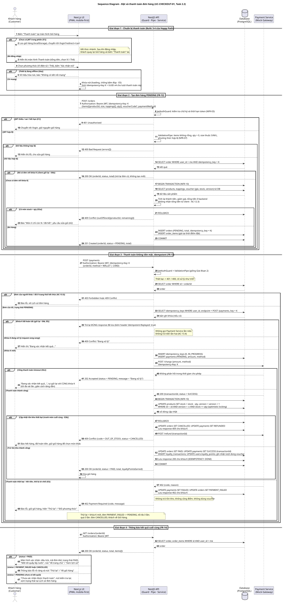

# Sequence Diagram: Đặt và Thanh toán đơn hàng (UC-CHECKOUT-01)

- **Task:** 2.2 – Sequence diagram cho use case trọng tâm (Task 1.3)
- **Use case:** UC-CHECKOUT-01 – Đặt món và Thanh toán không dùng tiền mặt (`use-case-checkout.md`)
- **Tệp nguồn / kết xuất:** `sequence-checkout.puml` / `sequence-checkout.svg`
- **Yêu cầu liên quan (SRS):** FR-02, FR-12, FR-13, FR-14 · NFR-03, NFR-07, NFR-09, NFR-10

---

## 1. Các lifeline

| Lifeline | Vai trò | Thành phần mã nguồn dự kiến |
| :--- | :--- | :--- |
| **Customer** | Khách hàng thao tác trên điện thoại/trình duyệt. | – |
| **Next.js UI** | Giao diện PWA mobile-first: giữ giỏ hàng, sinh `Idempotency-Key`, hiển thị loading/lỗi/xác nhận. | `apps/web` (hoặc `frontend/`) |
| **NestJS API** | `JwtAuthGuard` (xác thực), `ValidationPipe` (validate DTO), `OrdersService`, `PaymentsService`. | `apps/api` (hoặc `backend/`): module `orders`, `payments`, `auth` |
| **Database** | PostgreSQL: `orders`, `order_items`, `payments`, `products`, `users`, `loyalty_transactions`, `idempotency_keys`. | Migration / entity của backend |
| **Payment Service** | Cổng thanh toán mô phỏng (Ví điện tử / Thẻ), hỗ trợ `Idempotency-Key` và hoàn tiền. | Mock Payment Gateway |

---

## 2. Hợp đồng API được sử dụng

| API | Header bắt buộc | Request | Response chính |
| :--- | :--- | :--- | :--- |
| `POST /orders` | `Authorization: Bearer <JWT>`, `Idempotency-Key` | `items[{productId, size, toppings[], qty}]`, `voucherCode?`, `paymentMethod` | `201` `{orderId, status: PENDING, total}` · `400` · `401` · `409` (hết hàng) |
| `POST /payments` | `Authorization: Bearer <JWT>`, `Idempotency-Key` | `{orderId, method: WALLET \| CARD}` | `200` `{orderId, status: PAID, total, loyaltyPointsEarned}` · `202` (đang xử lý) · `402` (thanh toán thất bại) · `403`/`409` · `409` (hết hàng sau khi trả) |
| `GET /orders/:id` | `Authorization: Bearer <JWT>` | – | `200` `{orderId, status, total, items[]}` (chỉ trả đơn của chính người dùng) |
| Mock Gateway `POST /charge` | `Idempotency-Key` | `{amount, method}` | `200` SUCCESS · `402` bị từ chối · timeout |
| Mock Gateway `POST /refund` | – | `{transactionId}` | `200` đã hoàn tiền |

> Tên đường dẫn và mã HTTP là **thiết kế đề xuất** của sơ đồ. Khi backend hiện thực, cần giữ khớp hoặc cập nhật lại sơ đồ qua pull request.

---

## 3. Mô tả tuần tự các bước

Số bước trong bảng trùng với số tự động đánh trên sơ đồ.

### Giai đoạn 1 – Chuẩn bị thanh toán (bước 1–6, Happy Path bước 3–4)

| Bước | Mô tả |
| :---: | :--- |
| 1 | Khách hàng bấm **"Thanh toán"** tại màn hình Giỏ hàng. |
| 2 | *(E1)* Nếu chưa có JWT: UI lưu giỏ hàng vào localStorage, chuyển tới `/login?redirect=/cart`. Nhánh kết thúc; sau đăng nhập khách bấm lại. |
| 3 | Đã đăng nhập: UI hiển thị màn hình Thanh toán với tổng tiền và lựa chọn Ví / Thẻ. |
| 4 | Khách chọn phương thức và bấm **"Xác nhận trả"**. |
| 5 | *(E4a)* Nếu thiết bị offline: vô hiệu hóa nút và báo "Không có kết nối mạng"; chưa gọi API nào. |
| 6 | Có mạng: UI khóa nút (chống bấm đúp, E5) và sinh `Idempotency-Key` **K** (UUID v4) cho lượt thanh toán này. |

### Giai đoạn 2 – Tạo đơn hàng `PENDING` (bước 7–26, FR-12)

| Bước | Mô tả |
| :---: | :--- |
| 7 | UI gọi `POST /orders` kèm JWT, khóa K và nội dung giỏ hàng. **Không gửi tổng tiền.** |
| 8–10 | `JwtAuthGuard` kiểm tra chữ ký và thời hạn token (NFR-03). Sai/hết hạn → `401`, UI chuyển về `/login` và giữ giỏ hàng (E1). |
| 11–13 | `ValidationPipe` kiểm tra dữ liệu (giỏ không rỗng, `qty > 0`, size thuộc S/M/L, phương thức hợp lệ – NFR-07). Sai → `400` kèm danh sách lỗi. |
| 14–16 | API tìm đơn có cùng `(user_id, idempotency_key = K)`. Nếu đã có (client gửi lại) → trả lại đơn cũ, **không tạo đơn mới** (E4b). |
| 17–20 | **Bắt đầu transaction.** Đọc giá, topping, `stock`, `version` và voucher từ DB; **tính lại** thành tiền, giảm giá và tổng tiền ở backend (AC-12.3). |
| 21–23 | *(E2a)* Có món `stock < qty` → `ROLLBACK`, trả `409` kèm danh sách món thiếu; UI yêu cầu khách sửa giỏ (A2). |
| 24–26 | Đủ hàng → `INSERT orders` (`PENDING`, `idempotency_key = K`) và `order_items` (lưu giá tại thời điểm đặt) → `COMMIT` → trả `201` `{orderId, status: PENDING, total}`. |

### Giai đoạn 3 – Thanh toán không tiền mặt (bước 27–60, FR-13)

| Bước | Mô tả |
| :---: | :--- |
| 27–28 | UI gọi `POST /payments` với `{orderId, method}`, **cùng khóa K**. API lặp lại bước kiểm tra JWT và validate (thất bại → `401`/`400`). |
| 29–32 | API đọc đơn: đơn của người khác hoặc đã ở trạng thái kết thúc (`PAID`, `COMPLETED`, `CANCELLED`) → `403`/`409` (AC-13.5). |
| 33–35 | API tra bảng `idempotency_keys` theo `(user, endpoint, K)`. Nếu khóa **đã hoàn tất** → trả lại **đúng response đã lưu** (header `Idempotent-Replayed: true`); **không gọi cổng thanh toán**, không trừ tiền lần hai (AC-13.4; E4b, E5). |
| 36–37 | Khóa đang `IN_PROGRESS` (request song song) → `409 Đang xử lý`; UI hiển thị "Đang xác nhận kết quả...". |
| 38–39 | Khóa mới: `INSERT idempotency_keys (K, IN_PROGRESS)` và `INSERT payments (PENDING)`, rồi gọi `POST /charge` của Payment Service kèm cùng khóa K. |
| 40–42 | *(E4c)* Cổng timeout → API trả `202` (đang xử lý), đơn giữ `PENDING`; UI hiển thị "Đang xác nhận kết quả..." và **gửi lại với cùng khóa K**. |
| 43 | Cổng trả thành công `{transactionId, SUCCESS}`. |
| 44–46 | **Bắt đầu transaction** cập nhật tồn kho bằng optimistic locking: `UPDATE products SET stock = stock - qty, version = version + 1 WHERE id AND version = :v AND stock >= qty`. |
| 47–51 | *(E2b)* Cập nhật thất bại (hai khách tranh món cuối) → `ROLLBACK`, đơn `CANCELLED`, thanh toán `REFUNDED`, gọi `POST /refund`, trả `409 OUT_OF_STOCK`; UI báo hết hàng, đã hoàn tiền, giữ giỏ. |
| 52–56 | Thành công → trong cùng transaction: `orders = PAID`, `payments = SUCCESS`, ghi `loyalty_transactions`, cộng `users.loyalty_points`, ghi nhận lượt dùng voucher; lưu response `200` cho khóa K; `COMMIT`; trả `200 {orderId, status: PAID, loyaltyPointsEarned}`; UI xóa giỏ hàng. |
| 57–60 | *(E3)* Cổng từ chối → `payments = FAILED`, `orders = PAYMENT_FAILED`, lưu response `402` cho khóa K; **không** trừ kho, **không** cộng điểm, **không** dùng voucher. UI báo lỗi, giữ giỏ, cho **"Thử lại"** / **"Đổi phương thức"**. Thử lại dùng **khóa K mới**, đơn `PAYMENT_FAILED → PENDING`, tối đa 3 lần; quá 3 lần → `CANCELLED`. |

### Giai đoạn 4 – Thông báo kết quả cuối cùng (bước 61–67, FR-14)

| Bước | Mô tả |
| :---: | :--- |
| 61–64 | UI gọi `GET /orders/:id` để lấy trạng thái chính xác từ hệ thống (nguồn dữ liệu đúng), chỉ trả đơn của chính người dùng. |
| 65 | `PAID`: màn hình xác nhận (dấu tick, mã đơn `#id`, trạng thái `PAID`, "Mời tới quầy lấy nước", nút "Về trang chủ" / "Xem lịch sử") – AC-14.1, AC-14.2. |
| 66 | `PAYMENT_FAILED` hoặc `CANCELLED`: thông báo lỗi rõ ràng, nút "Thử lại" / "Về giỏ hàng" – AC-14.3. |
| 67 | `PENDING` (chưa có kết quả): "Chưa xác nhận được thanh toán", nút kiểm tra lại; khách xem trạng thái tại Lịch sử đơn hàng. |

---

## 4. Cơ chế Idempotency

| Nội dung | Thiết kế |
| :--- | :--- |
| **Khóa** | UI sinh `Idempotency-Key` (UUID v4) khi khách bấm "Xác nhận trả"; dùng chung cho `POST /orders` và `POST /payments` của cùng một lượt thanh toán. |
| **Phạm vi** | Khóa được lưu theo `(user_id, endpoint, key)`; hai người dùng không thể đụng khóa của nhau. |
| **Trạng thái** | `IN_PROGRESS` → `DONE` (kèm mã HTTP và body của response). |
| **Gửi lại cùng khóa** | `DONE` → trả lại nguyên response đã lưu, không xử lý lại. `IN_PROGRESS` → `409 Đang xử lý`. |
| **Cổng thanh toán** | Khóa K cũng được gửi tới Mock Gateway nên cổng không trừ tiền hai lần ngay cả khi API gọi lặp. |
| **Khi nào dùng khóa mới** | Chỉ khi khách chủ động thử lại sau thanh toán thất bại (E3). Khóa cũ gắn với kết quả thất bại nên không thể tái sử dụng. |
| **Hết hạn** | Bản ghi khóa có thể được dọn sau một khoảng thời gian (ví dụ 24 giờ). |

---

## 5. Transaction và trạng thái đơn

| Transaction | Vị trí | Nội dung | Nếu lỗi |
| :--- | :--- | :--- | :--- |
| **T1 – Tạo đơn** | Bước 17–25 | Đọc giá/stock, kiểm tra tồn kho, `INSERT orders` + `order_items`. | `ROLLBACK`, không có đơn nào được tạo (AC-12.5). |
| **T2 – Ghi nhận thanh toán thành công** | Bước 44–54 | Trừ kho (optimistic locking), `orders = PAID`, `payments = SUCCESS`, loyalty, voucher, lưu response idempotency. | `ROLLBACK`; đơn `CANCELLED` và hoàn tiền (E2b). |

Chuyển trạng thái trong sơ đồ:
`PENDING → PAID` (thanh toán thành công) · `PENDING → PAYMENT_FAILED` (cổng từ chối) · `PAYMENT_FAILED → PENDING` (thử lại, tối đa 3 lần) · `PENDING/PAYMENT_FAILED → CANCELLED` (quá 3 lần, hết hàng sau khi trả, hoặc quá 15 phút chưa có kết quả).

---

## 6. Truy vết với Use case và SRS

| Nội dung trên sơ đồ | Luồng trong `use-case-checkout.md` | Yêu cầu / Tiêu chí chấp nhận |
| :--- | :--- | :--- |
| Bấm "Thanh toán", kiểm tra JWT, chuyển `/login` | Happy Path bước 3; **E1** | FR-02, NFR-03 |
| Validate dữ liệu ở backend | Happy Path bước 4 | NFR-07, AC-12.2 |
| Tạo đơn `PENDING`, tính lại tiền ở backend | Happy Path bước 4 | FR-12, AC-12.1, AC-12.3 |
| Transaction + rollback khi hết hàng | **E2a** | NFR-10, AC-12.4, AC-12.5 |
| Gọi Payment Service kèm `Idempotency-Key` | Happy Path bước 5 | FR-13 |
| Trừ kho, `PAID`, cộng điểm, xóa giỏ | Happy Path bước 6 | FR-13, AC-13.2, NFR-10 |
| Tranh món cuối → hủy và hoàn tiền | **E2b** | NFR-10, NFR-09 |
| Nhánh `alt` thanh toán thất bại, thử lại | **E3** | AC-13.3, AC-14.3, NFR-09 |
| Gửi lại cùng khóa, timeout, offline, bấm nhiều lần | **E4a–c, E5** | AC-13.4, NFR-08, NFR-09 |
| Không thanh toán đơn người khác / đơn đã kết thúc | – | AC-13.5, NFR-04 |
| Màn hình xác nhận / lỗi / chờ | Happy Path bước 7 | FR-14, AC-14.1–14.3 |

---

## 7. Giả định thiết kế (cần thống nhất khi hiện thực)

1. **Hai lời gọi riêng:** `POST /orders` tạo đơn, `POST /payments` thanh toán (theo Happy Path bước 4–5). Cách gộp một API cần cập nhật lại sơ đồ.
2. **Trừ kho khi thanh toán thành công** (Happy Path bước 6), không giữ chỗ khi tạo đơn. Vì vậy phải có nhánh E2b; nếu nhóm chọn giữ chỗ tồn kho khi tạo đơn thì E2b biến mất.
3. **Voucher** được kiểm tra lại trong T1; lượt dùng chỉ bị trừ khi `PAID` (A1).
4. Tên bảng (`idempotency_keys`, `loyalty_transactions`...) và mã HTTP là đề xuất; class diagram (Task 2.3) và migration cần đồng bộ với các tên này.
