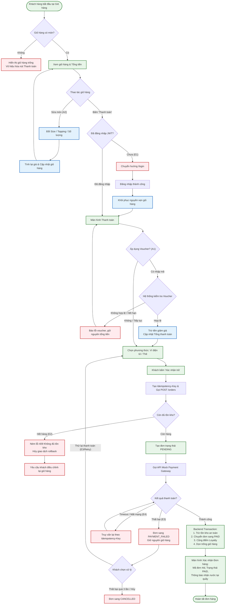

# Đặc tả Use Case Chi tiết: Luồng Đặt món & Thanh toán (Checkout Flow)
- **Mã Use Case:** UC-CHECKOUT-01 (Task 1.3)
- **Tên Use Case:** Đặt món và Thanh toán không dùng tiền mặt
- **Phụ trách:** Thành viên 6 & Thành viên 7
- **Dự án:** BrewLite

---

## 1. Tác nhân (Actors)
- **Tác nhân chính (Primary Actor):** Khách hàng (Customer) – Người dùng ứng dụng để xem menu, chọn size, topping, kiểm tra giỏ hàng và tiến hành thanh toán trực tuyến.
- **Tác nhân hỗ trợ (Secondary Actor):** Mock Payment Service (Cổng thanh toán mô phỏng Ví điện tử / Thẻ ngân hàng).

---

## 2. Điều kiện kích hoạt (Trigger)
- Khách hàng nhấn nút **"Thanh toán"** tại màn hình giỏ hàng sau khi đã chọn xong các món đồ uống.

---

## 3. Tiền điều kiện (Pre-conditions)
1. Giỏ hàng có ít nhất **01 sản phẩm**.
2. Sản phẩm còn đủ số lượng tồn kho trong cơ sở dữ liệu (`stock > 0`).
3. Khách hàng đã hoàn tất đăng nhập tài khoản và sở hữu Token JWT hợp lệ.

---

## 4. Hậu điều kiện (Post-conditions)
1. Một bản ghi đơn hàng mới được tạo trong bảng `Order` và chuyển sang trạng thái `PAID`.
2. Tồn kho sản phẩm được cập nhật giảm an toàn (sử dụng Transaction và Optimistic Locking).
3. Khách hàng nhận được một **Mã đơn hàng** duy nhất (ví dụ: `#1042`) kèm màn hình xác nhận.
4. Điểm thưởng (Loyalty Points) được tích lũy vào tài khoản của khách hàng.
5. Giỏ hàng hiện tại được dọn trống để chuẩn bị cho lượt đặt tiếp theo.

---

## 5. Luồng sự kiện chính (Happy Path)

| Bước | Tác nhân (Actor) | Phản hồi của Hệ thống (System Response) |
| :---: | :--- | :--- |
| **1** | Khách hàng mở ứng dụng, duyệt menu và chọn một món đồ uống (ví dụ: Cappuccino). | Hệ thống hiển thị giao diện chi tiết món: danh sách size (S/M/L) và topping cùng giá bán tương ứng. |
| **2** | Khách hàng chọn size (Size M), chọn topping mong muốn và nhấn **"Thêm vào giỏ"**. | Hệ thống ghi nhận sản phẩm vào state giỏ hàng (Zustand/Context), cập nhật số lượng badge và tự động tính tổng tiền. |
| **3** | Khách hàng mở màn hình Giỏ hàng, kiểm tra lại danh sách món và bấm nút **"Thanh toán"**. | Hệ thống kiểm tra phiên đăng nhập (JWT token hợp lệ) và hiển thị màn hình Thanh toán với tổng tiền chính xác. |
| **4** | Khách hàng chọn phương thức thanh toán không tiền mặt (**Ví điện tử** hoặc **Thẻ ngân hàng**) và bấm **"Xác nhận trả"**. | Frontend gọi API `POST /orders` để tạo đơn ở trạng thái `PENDING`, đồng thời tạo một mã `Idempotency-Key` duy nhất. |
| **5** | *(Hệ thống tự động thực thi)* | Backend NestJS gọi API `POST /payments` gửi yêu cầu thanh toán kèm `Idempotency-Key` sang Cổng thanh toán giả lập (Mock Payment Gateway). |
| **6** | Cổng thanh toán giả lập xác nhận giao dịch thành công. | Backend thực hiện transaction: kiểm tra & trừ tồn kho an toàn, chuyển trạng thái đơn hàng sang `PAID`, cộng điểm tích lũy và phản hồi kết quả về Frontend. |
| **7** | Khách hàng xem màn hình xác nhận đặt hàng thành công. | Giao diện hiển thị: dấu tick thành công, Mã đơn (ví dụ: `#1042`), Trạng thái `PAID`, thông báo *"Mời tới quầy lấy nước"* và nút bấm *"Về trang chủ"*. |

---

## 6. Sơ đồ quy trình chi tiết (Activity / Flowchart Diagram)

---

## 7. Luồng thay thế (Alternate Flows)

### A1 – Áp dụng voucher (rẽ nhánh từ Bước 3 hoặc Bước 4)
- **Điều kiện kích hoạt:** Khách hàng nhập mã voucher tại màn hình Giỏ hàng / chọn phương thức thanh toán rồi bấm **"Áp dụng"**.

| Bước | Tác nhân | Phản hồi của Hệ thống |
| :---: | :--- | :--- |
| A1.1 | Khách hàng nhập mã voucher và bấm **"Áp dụng"**. | Frontend kiểm tra định dạng (không rỗng, đúng độ dài); gửi mã lên backend cùng nội dung giỏ hàng. |
| A1.2 | *(Hệ thống tự động)* | Backend kiểm tra voucher: tồn tại, đang hoạt động, chưa hết hạn, đạt giá trị đơn tối thiểu, chưa hết lượt dùng. |
| A1.3 | *(Hệ thống tự động)* | Voucher hợp lệ: tính số tiền giảm, hiển thị lại **Tạm tính – Giảm giá – Tổng thanh toán**. Số tiền cuối cùng này được dùng ở Bước 4–5. |
| A1.4 | Khách hàng tiếp tục từ **Bước 4**. | Luồng chính tiếp tục; đơn lưu kèm mã voucher và số tiền giảm. |

- **Nhánh lỗi A1-x – Voucher không hợp lệ:** (không tồn tại / hết hạn / chưa đạt giá trị tối thiểu / hết lượt) → hiển thị thông báo lý do cụ thể, **không** thay đổi tổng tiền, khách hàng có thể nhập mã khác hoặc bỏ qua và tiếp tục Bước 4.
- **Ràng buộc:** Mỗi đơn chỉ áp dụng tối đa **1** voucher; tổng thanh toán sau giảm không âm (tối thiểu 0); voucher được kiểm tra lại ở backend khi tạo đơn (không tin số tiền do client gửi).
- **Hậu điều kiện:** Đơn có `discount_amount` và `voucher_code`; lượt dùng voucher chỉ bị trừ khi đơn chuyển sang `PAID`.

### A2 – Đổi size / topping / số lượng trong giỏ hàng (rẽ nhánh từ Bước 3)

| Bước | Tác nhân | Phản hồi của Hệ thống |
| :---: | :--- | :--- |
| A2.1 | Tại màn hình Giỏ hàng, khách hàng bấm **"Sửa"** trên một món. | Hiển thị lại tùy chọn hiện tại (Size S/M/L, Topping, số lượng) của món đó. |
| A2.2 | Khách hàng đổi size, thêm/bớt topping hoặc đổi số lượng, bấm **"Cập nhật"**. | Hệ thống tính lại đơn giá dòng (giá size + phụ thu topping) × số lượng, cập nhật tổng tiền và badge giỏ hàng. |
| A2.3 | *(Hệ thống tự động)* | Nếu đã áp voucher (A1) thì kiểm tra lại điều kiện voucher với tổng mới; không còn đạt điều kiện → gỡ voucher và báo cho khách. |
| A2.4 | Khách hàng quay lại **Bước 3**. | Luồng chính tiếp tục với giỏ hàng đã cập nhật. |

- **Biến thể A2b – Xóa món / giảm số lượng về 0:** Món bị xóa khỏi giỏ, tổng tiền tính lại. Nếu giỏ hàng **rỗng** thì nút "Thanh toán" bị vô hiệu hóa và hiển thị trạng thái giỏ trống kèm nút quay lại thực đơn (không vào được Bước 4).
- **Hậu điều kiện:** Giỏ hàng phản ánh đúng lựa chọn mới; chưa có đơn nào được tạo.

### A3 – Đổi phương thức thanh toán trước khi xác nhận (rẽ nhánh từ Bước 4)
- Tại Bước 4 khách hàng chuyển giữa **Ví điện tử** và **Thẻ ngân hàng** trước khi bấm **"Xác nhận trả"**. Hệ thống chỉ cập nhật lựa chọn trên giao diện (và các trường nhập liệu tương ứng đối với Thẻ); chưa tạo đơn và chưa gọi cổng thanh toán. Sau đó tiếp tục Bước 4 bình thường.

---

## 8. Luồng ngoại lệ (Exception Flows)

### E1 – Chưa đăng nhập hoặc JWT hết hạn khi xác nhận tạo đơn (Bước 3–4)
- **Phát hiện:** Khách hàng chưa có token, hoặc backend trả `401 Unauthorized` khi gọi `POST /orders` (token thiếu/sai/hết hạn).
- **Xử lý:** Lưu giỏ hàng (localStorage) → chuyển sang trang đăng nhập `/login` kèm đường dẫn quay lại. Đăng nhập thành công → tự động quay lại Giỏ hàng, **giỏ hàng và voucher còn nguyên**; khách bấm "Thanh toán" lại từ Bước 3.
- **Kết quả:** Chưa tạo đơn nào. Nếu khách hủy đăng nhập, giỏ hàng vẫn được giữ.

### E2 – Hết hàng (Bước 4 và Bước 6)
- **E2a – Hết hàng khi tạo đơn (Bước 4):** Trong transaction tạo đơn, backend kiểm tra tồn kho từng sản phẩm; `stock` không đủ cho số lượng yêu cầu → rollback toàn bộ, **không** tạo đơn, trả lỗi `409 Conflict` kèm danh sách món thiếu hàng và số lượng còn lại.
  - Hệ thống hiển thị thông báo "Món X chỉ còn N phần / đã hết hàng", đánh dấu món lỗi trong giỏ và yêu cầu khách giảm số lượng hoặc xóa món (A2) rồi quay lại Bước 3.
- **E2b – Tồn kho thay đổi giữa lúc tạo đơn và lúc ghi nhận thanh toán (Bước 6):** Hai khách mua món cuối cùng cùng lúc → optimistic locking của tồn kho thất bại.
  - Đơn chuyển sang `CANCELLED`, backend gọi hủy/hoàn tiền giao dịch (nếu cổng đã trừ tiền), thông báo cho khách và đề nghị chọn món khác. Giỏ hàng được giữ lại.
- **Kết quả:** Không có đơn `PAID` nào khi tồn kho không đủ; tồn kho không bao giờ âm.

### E3 – Giao dịch thanh toán thất bại (Bước 5–6)
- **Nguyên nhân thường gặp:** Ví không đủ số dư, thẻ không hợp lệ/bị từ chối, cổng thanh toán trả lỗi.
- **Xử lý của hệ thống:**
  1. Ghi nhận bản ghi thanh toán là thất bại (kèm mã lỗi), chuyển đơn sang `PAYMENT_FAILED`.
  2. **Không** trừ tồn kho, **không** cộng điểm Loyalty, **không** sử dụng lượt voucher.
  3. Giữ nguyên giỏ hàng và voucher; hiển thị lý do lỗi dễ hiểu.
  4. Hiển thị hai lựa chọn: **"Thử lại"** hoặc **"Đổi phương thức"**.
- **Thử lại:** Mỗi lần thử là một lần thanh toán mới với `Idempotency-Key` **mới**. Đơn quay lại `PENDING` khi bắt đầu lần thử mới; giới hạn tối đa **3** lần thử cho mỗi đơn, vượt quá thì đơn chuyển sang `CANCELLED` và khách được đưa về Giỏ hàng.

### E4 – Mất mạng, timeout hoặc rớt kết nối giữa chừng (Bước 5–6)
- **E4a – Mất mạng ở Client trước khi bấm xác nhận:** Frontend phát hiện offline → vô hiệu hóa nút "Xác nhận trả", hiển thị thông báo "Không có kết nối mạng".
- **E4b – Mất mạng sau khi Client đã bấm gửi request:** Client gửi lại request với cùng `Idempotency-Key`.
  - Backend nhận khóa đã tồn tại → trả lại **đúng kết quả đã lưu** (đơn/thanh toán cũ), tuyệt đối không tạo đơn mới hay trừ tiền lần hai.
  - Đơn ở `PENDING` quá thời hạn quy định (15 phút) mà chưa có kết quả thanh toán thì được hệ thống chuyển `CANCELLED`.
- **E4c – Cổng thanh toán (Mock) timeout:** Backend đặt timeout cho lời gọi cổng; hết thời gian thì đơn giữ `PENDING`, trả lỗi "đang xử lý" cho frontend và truy vấn lại kết quả bằng cùng `Idempotency-Key`; không tự động trừ tiền lần nữa.

### E5 – Khách bấm xác nhận nhiều lần / mở nhiều tab (Bước 4)
- Frontend vô hiệu hóa nút ngay sau lần bấm đầu (trạng thái loading). Nếu vẫn có nhiều request đến backend cùng `Idempotency-Key` → chỉ xử lý một, các request còn lại nhận lại cùng kết quả. Hai tab dùng hai khóa khác nhau nhưng cùng giỏ hàng → hai đơn riêng, mỗi đơn vẫn kiểm tra tồn kho độc lập như E2.

---

## 9. Liên kết Use Case với Yêu cầu (Traceability Matrix)

### 9.1. Ánh xạ Luồng → Yêu cầu Chức năng (FR) & Phi chức năng (NFR)

| Luồng | FR liên quan (SRS) | NFR liên quan (SRS) | Tiêu chí chấp nhận |
| :--- | :--- | :--- | :--- |
| **Happy Path (Bước 1–7)** | FR-03, FR-04, FR-05, FR-06, FR-07, FR-10, FR-01, FR-02, FR-12, FR-13, FR-14 | NFR-03, NFR-04, NFR-10 | Giỏ hợp lệ và đã đăng nhập, thanh toán thành công → đơn `PAID`, có mã đơn duy nhất, tồn kho giảm an toàn, giỏ rỗng, điểm thưởng được cộng. |
| **A1 – Áp dụng Voucher** | FR-10, FR-12 | NFR-07 | Voucher hợp lệ → tổng tiền = tạm tính − giảm; voucher sai/hết hạn → báo lỗi và tổng tiền không đổi; backend tự tính lại tiền khi tạo đơn. |
| **A2 – Đổi size / topping / số lượng** | FR-05, FR-07, FR-08, FR-09, FR-10, FR-11 | NFR-08, NFR-19 | Đổi size/topping → đơn giá và tổng tiền cập nhật đúng; xóa hết món → nút "Thanh toán" bị vô hiệu; voucher không còn hợp lệ sau khi đổi giỏ thì bị gỡ. |
| **A3 – Đổi phương thức thanh toán** | FR-13 | NFR-08 | Đổi Ví ↔ Thẻ không tạo đơn và không gọi cổng thanh toán cho đến khi bấm xác nhận. |
| **E1 – Chưa đăng nhập / JWT hết hạn** | FR-02, FR-12 | NFR-03 | `POST /orders` không token hoặc token sai/hết hạn → `401`; sau đăng nhập quay lại giỏ và giỏ còn nguyên; không có đơn nào bị tạo nhầm. |
| **E2 – Hết hàng tồn kho** | FR-06, FR-08, FR-12 | NFR-09, NFR-10 | `stock` < số lượng yêu cầu → `409 Conflict`, không tạo đơn, rollback; hai request tranh món cuối cùng → tối đa một đơn `PAID`, `stock` không âm. |
| **E3 – Thanh toán thất bại** | FR-12, FR-13 | NFR-08, NFR-09 | Cổng từ chối → đơn `PAYMENT_FAILED`, tồn kho/điểm không đổi, giỏ còn nguyên; cho phép thử lại tối đa 3 lần bằng khóa mới; vượt quá 3 lần chuyển `CANCELLED`. |
| **E4 – Mất mạng / timeout** | FR-12, FR-13, FR-15 | NFR-09, NFR-10 | Gửi lại cùng `Idempotency-Key` → nhận cùng kết quả, chỉ **1** giao dịch thanh toán thành công; đơn `PENDING` xem được ở lịch sử. |
| **E5 – Bấm nút nhiều lần** | FR-12, FR-13 | NFR-10 | Nhiều request cùng `Idempotency-Key` → 1 đơn, 1 giao dịch duy nhất. |

### 9.2. Ánh xạ Use Case tổng quát (`usecase-overview`) → Yêu cầu (FR)

| Use Case trong Sơ đồ Tổng quát | Quan hệ | Mã Yêu cầu (SRS.md) |
| :--- | :--- | :--- |
| Xem danh sách thực đơn | Customer → UC | FR-03 |
| Xem chi tiết & Tùy chọn (Size/Topping) | `<<include>>` Quản lý giỏ hàng | FR-04, FR-05 |
| Quản lý giỏ hàng | Customer → UC | FR-06, FR-07, FR-08, FR-09, FR-10, FR-11 |
| Đổi size / topping trong giỏ hàng | `<<extend>>` Quản lý giỏ hàng (A2) | FR-05, FR-08 |
| Đăng ký tài khoản & Đăng nhập nhận JWT | Customer → UC; Checkout `<<include>>` Đăng nhập | FR-01, FR-02 |
| Thanh toán không tiền mặt | Customer → UC; `<<include>>` Tạo đơn, Đăng nhập, Xem xác nhận; → Mock Payment Gateway | FR-12, FR-13 |
| Tạo đơn hàng | `<<include>>` bởi Thanh toán | FR-12 |
| Áp dụng voucher | `<<extend>>` Thanh toán (A1) | FR-10, FR-12 |
| Thử lại / đổi phương thức khi thanh toán lỗi | `<<extend>>` Thanh toán (E3) | FR-13 |
| Tích lũy điểm (Loyalty) | `<<extend>>` Thanh toán | FR-01, FR-13 |
| Xem màn hình xác nhận đơn / Xem lịch sử đơn | Customer → UC | FR-14, FR-15 |