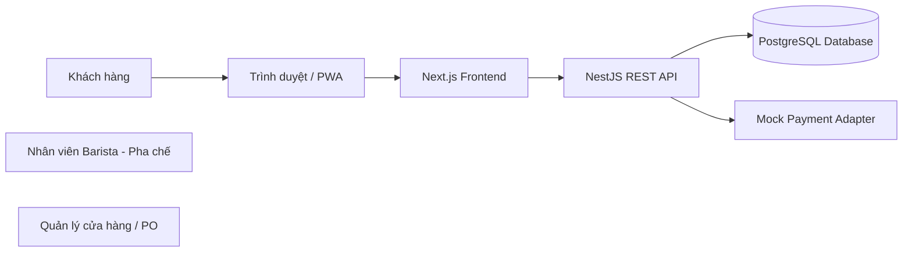
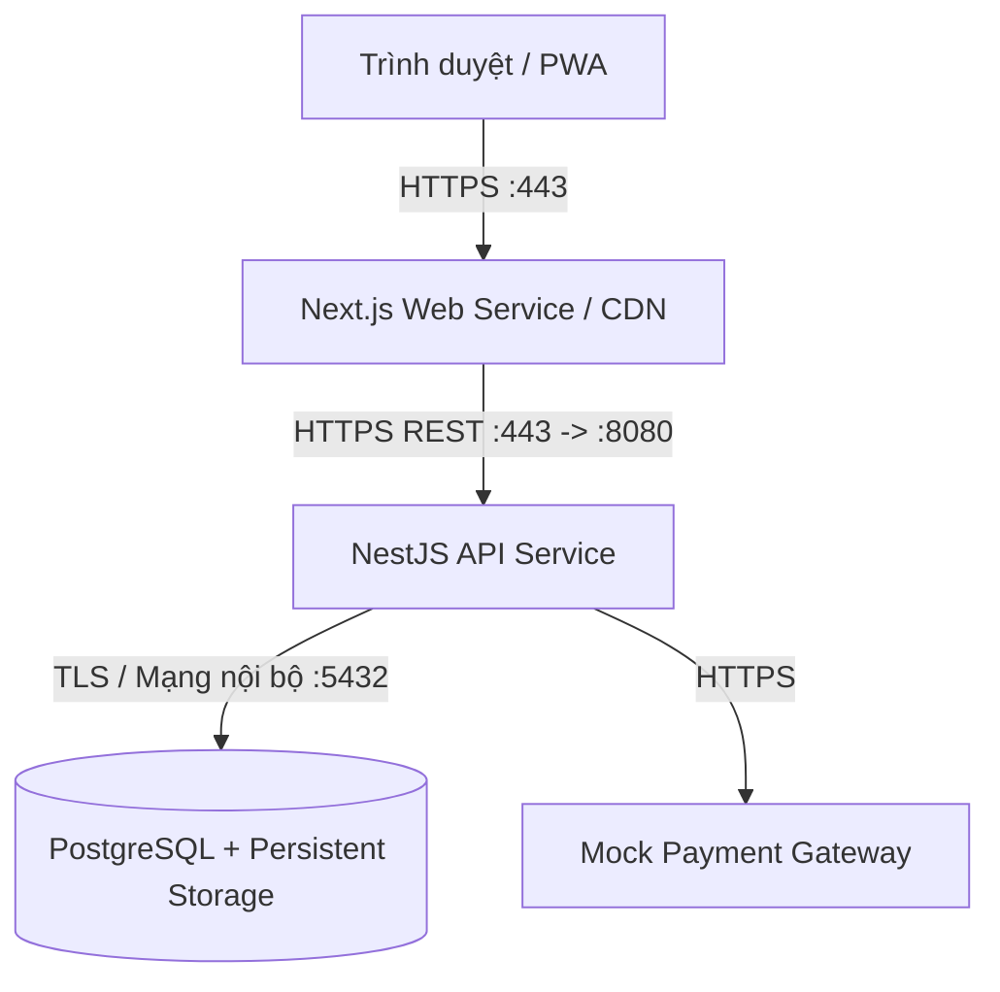

# BrewLite — Ứng dụng đặt cà phê không dùng tiền mặt

> **Đồ án môn học:** Công nghệ Phần mềm (Software Engineering) — Trường Đại học Sài Gòn (SGU)  
> **Phương pháp phát triển:** Agile Scrum  
> **Phiên bản:** Assignment 2 (Hoàn thành Giai đoạn Yêu cầu, Mô hình hóa & Thiết kế Kiến trúc)

---

## 1. Giới thiệu tổng quan

**BrewLite** là ứng dụng đặt cà phê trực tuyến không dùng tiền mặt (Cashless Coffee Ordering), giải quyết bài toán ùn tắc tại quầy thanh toán vào giờ cao điểm, tối ưu hóa quy trình pha chế của nhân viên Barista và nâng cao trải nghiệm đặt nước của khách hàng.

### Ngăn xếp công nghệ cốt lõi:
- **Frontend:** Next.js (React 19, TypeScript, TailwindCSS) — Thiết kế Mobile-first, hỗ trợ PWA.
- **Backend:** NestJS (TypeScript) — Kiến trúc Modular Monolith, RESTful API.
- **Cơ sở dữ liệu:** PostgreSQL 16+ kết hợp **Prisma ORM** và cơ chế Migration tự động.
- **Đóng gói & Triển khai:** Docker & Docker Compose, sẵn sàng cho môi trường đám mây PaaS (Render / Railway / Vercel).

---

## 2. Cấu trúc Repository (Monorepo)

Dự án áp dụng mô hình **Monorepo** tập trung toàn bộ mã nguồn Frontend, Backend và Tài liệu kỹ thuật theo quyết định tại [ADR-001](Docs/architecture/adr/001-monorepo.md):

```text
SWE_Project/
├── backend/                  # Dịch vụ API NestJS & Cấu hình Database
│   ├── src/                  # Mã nguồn ứng dụng (Modules, Controllers, Services)
│   ├── test/                 # Kịch bản kiểm thử (E2E & Integration tests)
│   ├── .env.example          # Biến môi trường mẫu Backend
│   └── package.json
├── frontend/                 # Ứng dụng Web / PWA Next.js
│   ├── app/                  # App Router (Trang giao diện, Layouts, Components)
│   ├── public/               # Tài nguyên tĩnh (Hình ảnh, Icons)
│   ├── .env.example          # Biến môi trường mẫu Frontend
│   └── package.json
├── Docs/                     # Toàn bộ tài liệu kỹ thuật & Thiết kế hệ thống
│   ├── requirements/         # Task 1: Bối cảnh, Phạm vi & Đặc tả yêu cầu (SRS)
│   │   ├── context-and-scope.md
│   │   └── SRS.md
│   ├── diagrams/             # Task 2: Các sơ đồ UML (PlantUML nguồn & ảnh SVG)
│   │   ├── activity-checkout.*   # Task 2.1: Activity Diagram
│   │   ├── sequence-checkout.*   # Task 2.2: Sequence Diagram (5 lifelines)
│   │   ├── class-domain.*        # Task 2.3: Domain Class Diagram & Data Dictionary
│   │   ├── deployment.*          # Task 3.2: Deployment Diagram Production
│   │   ├── usecase-overview.*    # Sơ đồ Use-case tổng quan toàn hệ thống
│   │   └── use-case-checkout.*   # Task 1.3: Đặc tả use-case trọng tâm
│   ├── architecture/         # Task 3.1: Kiến trúc hệ thống & Hồ sơ quyết định (ADR)
│   │   ├── README.md         # Chi tiết kiến trúc hệ thống
│   │   └── adr/              # ADR-001 (Monorepo), ADR-002 (Prisma), ADR-003 (State Machine)
│   ├── deployment.md         # Hướng dẫn chi tiết vận hành & triển khai Production
│   └── traceability-matrix.md# Task 8.1: Ma trận truy vết bắt buộc (15 FRs & 19 NFRs)
├── docker-compose.yml        # Khởi chạy PostgreSQL cục bộ có Persistent Volume
└── README.md                 # Tài liệu hướng dẫn chính của dự án
```

---

## 3. Tổng quan Kiến trúc Hệ thống

### 3.1. Bối cảnh Hệ thống (System Context)



### 3.2. Góc nhìn Triển khai Thành phần (Component Deployment)



### 3.3. Định hướng Backend: Modular Monolith
Backend NestJS được tổ chức thành các Module nghiệp vụ phân định ranh giới rõ ràng:
- **Auth Module:** Quản lý đăng ký, đăng nhập, xác thực JWT (`JwtAuthGuard`) và băm mật khẩu (`bcrypt`).
- **Users Module:** Thông tin người dùng, phân quyền RBAC (`Role`) và tích lũy điểm thưởng (`loyaltyPoints`).
- **Products Module:** Danh mục đồ uống, tùy chọn size, topping, giá bán và số lượng tồn kho (`stock`).
- **Orders Module:** Tạo đơn hàng, tự động tính tổng tiền ở phía server, kiểm soát đồng thời (Optimistic Locking) và máy trạng thái đơn hàng ([ADR-003](Docs/architecture/adr/003-state-machine.md)).
- **Payments Module:** Tích hợp cổng thanh toán mô phỏng (Mock Payment) cho Ví điện tử / Thẻ, bảo vệ giao dịch bằng khóa `Idempotency-Key`.
- **Common Module:** Cung cấp `PrismaService` dùng chung, bộ lọc ngoại lệ toàn cục, logging có cấu trúc và endpoint kiểm tra sức khỏe `GET /health`.

### 3.4. Vòng đời Trạng thái Đơn hàng (Order State Machine)
Đơn hàng được quản lý chặt chẽ qua **7 trạng thái chuẩn mực**:
- **Luồng thành công:** `PENDING` → `PAID` → `PREPARING` → `READY` → `COMPLETED`
- **Luồng lỗi / Thử lại:** `PENDING` → `PAYMENT_FAILED` ↔ `PENDING` *(hoặc rẽ nhánh sang `CANCELLED`)*
- **Trạng thái kết thúc:** `COMPLETED` *(Hoàn tất)* và `CANCELLED` *(Hủy đơn)*

---

## 4. Danh mục Quyết định Kiến trúc (ADR)

Mọi quyết định kỹ thuật cốt lõi đều được thảo luận và chính thức thông qua:
1. **[ADR-001: Tổ chức Repository theo mô hình Monorepo](Docs/architecture/adr/001-monorepo.md)** — *Accepted*
2. **[ADR-002: Lựa chọn lớp truy cập dữ liệu Prisma ORM & Migration](Docs/architecture/adr/002-orm-selection.md)** — *Accepted*
3. **[ADR-003: Quy định chuyển trạng thái đơn hàng (State Machine)](Docs/architecture/adr/003-state-machine.md)** — *Accepted*

---

## 5. Hướng dẫn Cài đặt & Khởi chạy Cục bộ (Local Development)

### 5.1. Yêu cầu Tiên quyết
- **Node.js:** Phiên bản 20.x hoặc 24.x LTS.
- **Docker & Docker Compose:** Dùng để chạy cơ sở dữ liệu PostgreSQL.
- **Git:** Quản lý mã nguồn.

### 5.2. Khởi động Cơ sở dữ liệu PostgreSQL
Khởi chạy container PostgreSQL nền tảng bằng Docker Compose:
```bash
docker compose up -d
```
Cơ sở dữ liệu sẽ chạy trên cổng `5435` (hoặc `5432`) kèm vùng lưu trữ bền vững `pgdata`.

### 5.3. Cài đặt & Chạy Backend (NestJS)
```bash
cd backend
npm install
copy .env.example .env    # Trên Linux/macOS: cp .env.example .env
npm run start:dev
```
- API chạy tại: `http://localhost:8080`
- Kiểm tra sức khỏe: `GET http://localhost:8080/health`

### 5.4. Cài đặt & Chạy Frontend (Next.js)
Mở một terminal mới:
```bash
cd frontend
npm install
copy .env.example .env    # Trên Linux/macOS: cp .env.example .env
npm run dev
```
- Giao diện người dùng chạy tại: `http://localhost:3000`

---

## 6. Quy trình Làm việc & Quy ước Nhóm (Agile Scrum)

### 6.1. Quy ước Đặt tên Commit (Conventional Commits)
- `[Feat]`: Thêm một tính năng mới.
- `[Fix]`: Sửa lỗi phần mềm.
- `[Docs]`: Cập nhật tài liệu kỹ thuật, sơ đồ, markdown.
- `[Style]`: Chỉnh sửa khoảng trắng, format code (không ảnh hưởng logic).
- `[Refactor]`: Tái cấu trúc code (không đổi tính năng, không fix bug).
- `[Test]`: Bổ sung hoặc sửa đổi kịch bản kiểm thử (unit, integration, e2e).
- `[Chore]`: Thay đổi cấu hình build, dependencies, workflow CI/CD.

### 6.2. Chiến lược Nhánh (Branching Strategy)
- Nhánh `main`: Nhánh ổn định, sẵn sàng triển khai; được bảo vệ (Branch Protection), không commit trực tiếp.
- Nhánh thành viên: `TV1` (Trưởng nhóm), `TV2`, `TV3`, `TV4`, `TV5`, `TV6`, `TV7`.
- Mọi đóng góp đều phải tạo **Pull Request (PR)** từ nhánh thành viên vào `main`, được kiểm tra xung đột và review trước khi merge.

### 6.3. Định nghĩa Hoàn thành (Definition of Done - DoD)
Một User Story / Task được coi là hoàn thành khi:
1. Mã nguồn tuân thủ coding conventions, không có cảnh báo linter.
2. Vượt qua 100% các bài Unit Test và Integration Test liên quan.
3. Tài liệu thiết kế (SRS, Sơ đồ, Ma trận truy vết) được cập nhật đồng bộ.
4. Được review và phê duyệt bởi ít nhất Trưởng nhóm qua Pull Request.

---

## 7. Mục lục Hồ sơ Tài liệu Đồ án (Docs Navigation)

| STT | Tài liệu / Sơ đồ | Đường dẫn tệp | Nhiệm vụ tương ứng |
| :---: | :--- | :--- | :---: |
| 1 | Bối cảnh, Stakeholder & Phạm vi | [`Docs/requirements/context-and-scope.md`](Docs/requirements/context-and-scope.md) | Task 1.1 |
| 2 | Đặc tả yêu cầu phần mềm (SRS) | [`Docs/requirements/SRS.md`](Docs/requirements/SRS.md) | Task 1.2 |
| 3 | Đặc tả Use-case trọng tâm Checkout | [`Docs/diagrams/use-case-checkout.md`](Docs/diagrams/use-case-checkout.md) | Task 1.3 |
| 4 | Sơ đồ Use-case tổng quát | [`Docs/diagrams/usecase-overview.svg`](Docs/diagrams/usecase-overview.svg) | Task 1.2 |
| 5 | Sơ đồ Hoạt động (Activity Diagram) | [`Docs/diagrams/activity-checkout.svg`](Docs/diagrams/activity-checkout.svg) | Task 2.1 |
| 6 | Sơ đồ Tuần tự (Sequence Diagram) | [`Docs/diagrams/sequence-checkout.svg`](Docs/diagrams/sequence-checkout.svg) | Task 2.2 |
| 7 | Sơ đồ Lớp miền & Từ điển dữ liệu | [`Docs/diagrams/class-domain.svg`](Docs/diagrams/class-domain.svg) · [Data Dict](Docs/diagrams/class-domain.md) | Task 2.3 |
| 8 | Tổng quan Kiến trúc & ADRs | [`Docs/architecture/README.md`](Docs/architecture/README.md) · [ADR Folder](Docs/architecture/adr/) | Task 3.1 |
| 9 | Sơ đồ Triển khai & Hướng dẫn Vận hành | [`Docs/diagrams/deployment.svg`](Docs/diagrams/deployment.svg) · [Hướng dẫn](Docs/deployment.md) | Task 3.2 |
| 10 | Ma trận Truy vết bắt buộc (RTM) | [`Docs/traceability-matrix.md`](Docs/traceability-matrix.md) | Task 8.1 |

---

## 8. Checklist Nghiệm thu Đồ án (Assignment 2)

- [x] **Tài liệu Yêu cầu:** SRS rút gọn, Context & Scope, Đặc tả use-case trọng tâm.
- [x] **Sơ đồ Thiết kế UML:** Đầy đủ Activity, Sequence (5 lifelines), Class (Domain) và Deployment.
- [x] **Kiến trúc & ADR:** Báo cáo kiến trúc Modular Monolith, 03 bản ADR chính thức.
- [x] **Truy vết Yêu cầu:** Ma trận truy vết RTM phủ 100% 15 FRs và 19 NFRs.
- [x] **Cấu trúc Monorepo:** Tách biệt `frontend/`, `backend/`, `Docs/`.
- [ ] **Mã nguồn MVP Sprint 1:** Triển khai API Menu và giao diện Web (Task 4.3).
- [ ] **Tự động hóa CI/CD:** Cấu hình GitHub Actions pipeline (Task 4.4).
- [ ] **Triển khai Production:** Triển khai thực tế trên Cloud PaaS (Task 5).
