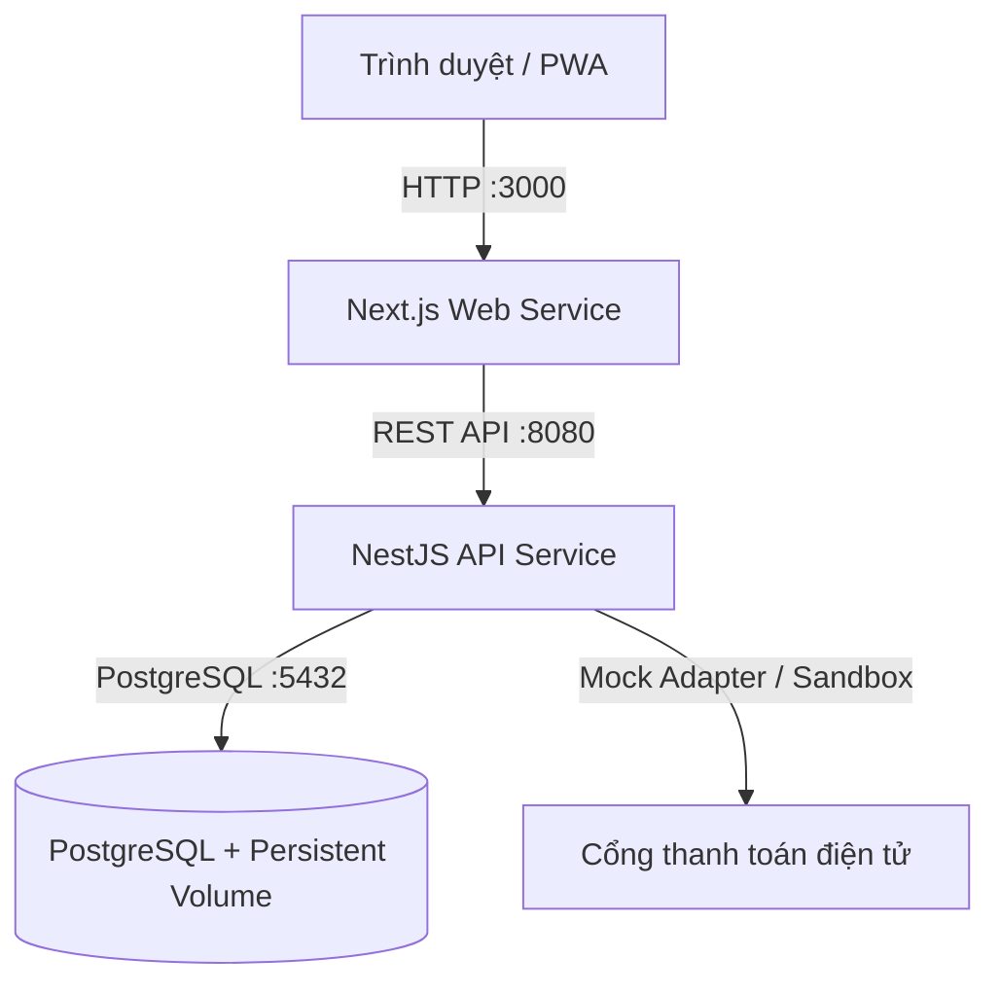

# BrewLite — Ứng dụng đặt cà phê không dùng tiền mặt

> **Đồ án môn học:** Công nghệ Phần mềm (Software Engineering) — Trường Đại học Sài Gòn (SGU)  
> **Phương pháp phát triển:** Agile Scrum  
> **Phiên bản:** Assignment 1 — Ứng dụng đặt cà phê không dùng tiền mặt (BrewLite) (Thang điểm 10/10)

---

## 1. Giới thiệu tổng quan

**BrewLite** là ứng dụng đặt cà phê trực tuyến không dùng tiền mặt (Cashless Coffee Ordering), giải quyết bài toán ùn tắc tại quầy thanh toán vào giờ cao điểm, tối ưu hóa quy trình pha chế của nhân viên Barista và nâng cao trải nghiệm đặt nước của khách hàng.

### Ngăn xếp công nghệ cốt lõi:
- **Frontend:** Next.js (React 19, TypeScript, TailwindCSS) — Thiết kế Mobile-first, hỗ trợ PWA, quản lý trạng thái giỏ hàng với Zustand Persist.
- **Backend:** NestJS (TypeScript) — Kiến trúc Modular Monolith, RESTful API, Swagger Documentation, State Machine kiểm soát vòng đời đơn hàng.
- **Cơ sở dữ liệu:** PostgreSQL 16+ kết hợp **Prisma ORM** và cơ chế Migration/Seed tự động.
- **Bảo mật & Đồng thời:** Băm mật khẩu `bcrypt`, xác thực `JWT Passport`, khóa thanh toán `Idempotency-Key`, kiểm soát tồn kho đồng thời với `Optimistic Locking` (cột `version`) và Pessimistic Row Lock (`SELECT FOR UPDATE`).
- **Đóng gói & Triển khai:** Docker & Docker Compose chạy đồng thời cả 3 dịch vụ (Frontend, Backend, Database).

---

## 2. Cấu trúc Repository (Monorepo)

Dự án áp dụng mô hình **Monorepo** tập trung toàn bộ mã nguồn Frontend, Backend và Tài liệu kỹ thuật theo quyết định tại [ADR-001](Docs/architecture/adr/001-monorepo.md):

```text
SWE_Project/
├── backend/                  # Dịch vụ API NestJS & Cấu hình Database
│   ├── src/                  # Mã nguồn ứng dụng (Auth, Users, Products, Orders, Payments)
│   ├── prisma/               # Schema CSDL, migrations tuần tự và script seed.ts
│   ├── test/                 # Kịch bản kiểm thử (E2E & Integration tests)
│   ├── .env.example          # Biến môi trường mẫu Backend
│   └── package.json
├── frontend/                 # Ứng dụng Web / PWA Next.js
│   ├── app/                  # App Router (Menu, Cart, Orders, Auth, Profile)
│   ├── components/           # UI Components (ProductCard, CartItem, CheckoutModal...)
│   ├── stores/               # Quản lý trạng thái client Zustand (cartStore)
│   ├── public/               # Tài nguyên tĩnh (Hình ảnh, Icons)
│   ├── .env.example          # Biến môi trường mẫu Frontend
│   └── package.json
├── Docs/                     # Toàn bộ tài liệu kỹ thuật & Thiết kế hệ thống
│   ├── requirements/         # Bối cảnh, Phạm vi & Đặc tả yêu cầu (SRS)
│   ├── diagrams/             # Các sơ đồ UML (Activity, Sequence, Class, State, Deployment)
│   ├── architecture/         # Kiến trúc hệ thống & Hồ sơ quyết định kỹ thuật (ADRs)
│   └── traceability-matrix.md# Ma trận truy vết yêu cầu (15 FRs & 19 NFRs)
├── docker-compose.yml        # Khởi chạy 3 dịch vụ: db (Postgres), backend, frontend
└── README.md                 # Tài liệu hướng dẫn chính của dự án
```

---

## 3. Tổng quan Kiến trúc Hệ thống

### 3.1. Bối cảnh Hệ thống (System Context)

```mermaid
flowchart LR
    Customer[Khách hàng] --> Browser[Trình duyệt / PWA]
    Browser --> FE[Next.js Frontend :3000]
    FE --> API[NestJS REST API :8080]
    API --> DB[(PostgreSQL Database :5432)]
    API --> Pay[Payment Adapter (Mock / VNPay)]

    Staff[Nhân viên Barista - Pha chế]
    Admin[Quản lý cửa hàng / PO]
```

### 3.2. Góc nhìn Triển khai Thành phần (Component Deployment)



### 3.3. Định hướng Backend: Modular Monolith
Backend NestJS được tổ chức thành các Module nghiệp vụ phân định ranh giới rõ ràng:
- **Auth Module:** Quản lý đăng ký, đăng nhập, phát JWT (`JwtAuthGuard`), băm mật khẩu (`bcrypt`).
- **Users Module:** Thông tin người dùng, phân quyền RBAC (`Role`) và tích lũy điểm thưởng loyalty.
- **Products Module:** Danh mục đồ uống, kích cỡ (S/M/L), topping, giá bán và số lượng tồn kho (`stock`).
- **Orders Module:** Tạo đơn hàng (`POST /orders`), tính tổng tiền an toàn trên server, State Machine đơn hàng và API đổi trạng thái (`PATCH /orders/:id/status`).
- **Payments Module:** Thanh toán không tiền mặt Mock (Ví điện tử / Thẻ ngân hàng) & VNPay, chống trùng bằng `Idempotency-Key`, kiểm soát tồn kho đồng thời với Optimistic Locking (`version` + `stock >= qty`).
- **Common Module:** Cung cấp `PrismaService` dùng chung, bộ lọc ngoại lệ toàn cục, logging có cấu trúc và healthcheck.

### 3.4. Vòng đời Trạng thái Đơn hàng (Order State Machine)
Đơn hàng được quản lý chặt chẽ qua **7 trạng thái chuẩn mực**:
- **Luồng thành công:** `PENDING` → `PAID` → `PREPARING` → `READY` → `COMPLETED`
- **Luồng lỗi / Thử lại:** `PENDING` → `PAYMENT_FAILED` ↔ `PENDING` *(hoặc rẽ nhánh sang `CANCELLED`)*
- **Trạng thái kết thúc:** `COMPLETED` *(Hoàn tất)* và `CANCELLED` *(Hủy đơn)*

---

## 4. Danh mục Quyết định Kiến trúc (ADR)

Mọi quyết định kỹ thuật cốt lõi đều được ghi nhận bằng văn bản ADR chính thức:
1. **[ADR-001: Tổ chức Repository theo mô hình Monorepo](Docs/architecture/adr/001-monorepo.md)** — *Accepted*
2. **[ADR-002: Lựa chọn lớp truy cập dữ liệu Prisma ORM & Migration](Docs/architecture/adr/002-orm-selection.md)** — *Accepted*
3. **[ADR-003: Quy định chuyển trạng thái đơn hàng (State Machine)](Docs/architecture/adr/003-state-machine.md)** — *Accepted*

---

## 5. Hướng dẫn Cài đặt & Khởi chạy Cục bộ (Local Development)

### 5.1. Yêu cầu Tiên quyết
- **Node.js:** Phiên bản 20.x hoặc 24.x LTS.
- **Docker & Docker Compose:** Dùng để chạy cơ sở dữ liệu PostgreSQL hoặc chạy trọn gói cả 3 service.
- **Git:** Quản lý mã nguồn.

### 5.2. Cách 1: Khởi chạy Trọn gói Bằng Docker Compose (Khuyến nghị cho Giảng viên/Nghiệm thu)
Chỉ cần 1 câu lệnh duy nhất từ thư mục gốc `SWE_Project/`:
```bash
docker compose up -d --build
```
Hệ thống sẽ tự động:
1. Khởi động PostgreSQL 16 (cổng 5432).
2. Chạy `npx prisma migrate deploy` và tự động nạp seed dữ liệu mẫu (sản phẩm, tài khoản test).
3. Khởi chạy Backend NestJS tại `http://localhost:8080`.
4. Khởi chạy Frontend Next.js tại `http://localhost:3000`.

*Lệnh dừng hệ thống:* `docker compose down`

---

### 5.3. Cách 2: Khởi chạy Từng Phần (Dành cho Lập trình viên)

#### Bước 1: Khởi động CSDL PostgreSQL
```bash
docker compose up -d db
```

#### Bước 2: Cài đặt và Chạy Backend (NestJS)
```bash
cd backend
npm install
copy .env.example .env    # Trên Linux/macOS: cp .env.example .env

# Chạy migration đồng bộ lược đồ CSDL
npx prisma migrate deploy

# Nạp dữ liệu mẫu (danh mục, đồ uống, toppings, mã giảm giá, tài khoản test)
npm run prisma:seed

# Khởi chạy dịch vụ API ở chế độ phát triển
npm run start:dev
```
- API chạy tại: `http://localhost:8080`
- Swagger API Docs: `http://localhost:8080/api/docs`
- Kiểm tra sức khỏe: `GET http://localhost:8080/health`

#### Bước 3: Cài đặt và Chạy Frontend (Next.js)
Mở một cửa sổ terminal mới:
```bash
cd frontend
npm install
copy .env.example .env    # Trên Linux/macOS: cp .env.example .env
npm run dev
```
- Giao diện người dùng chạy tại: `http://localhost:3000`

---

### 5.4. Tài Khoản Mẫu Để Kiểm Thử (Demo Credentials)

| Vai trò | Email đăng nhập | Mật khẩu | Quyền hạn / Mục đích |
| :--- | :--- | :--- | :--- |
| **Quản trị viên / Barista** | `admin@gmail.com` | `admin123` | Quản lý hệ thống, chuyển trạng thái pha chế đơn hàng |
| **Khách hàng** | `customer@gmail.com` | `123456` | Đặt món, thanh toán ví/thẻ, tích điểm loyalty, xem lịch sử đơn |

---

## 6. Quy trình Kiểm thử (Testing)

### Chạy Unit & Integration Test Backend:
```bash
cd backend
npm test
```
*(Hiện có 20 test suites, 290+ tests bao phủ toàn bộ các module và nghiệp vụ concurrency).*

### Chạy Linter:
```bash
cd backend && npm run lint
cd ../frontend && npm run lint
```

### Kiểm tra Build Production Frontend:
```bash
cd frontend && npm run build
```

---

## 7. Mục lục Hồ sơ Tài liệu Đồ án (Docs Navigation)

| STT | Tài liệu / Sơ đồ | Đường dẫn tệp | Nhiệm vụ tương ứng |
| :---: | :--- | :--- | :---: |
| 1 | Bối cảnh, Stakeholder & Phạm vi | [`Docs/requirements/context-and-scope.md`](Docs/requirements/context-and-scope.md) | Task 1.1 |
| 2 | Đặc tả yêu cầu phần mềm (SRS) | [`Docs/requirements/SRS.md`](Docs/requirements/SRS.md) | Task 1.2 |
| 3 | Đặc tả Use-case trọng tâm Checkout | [`Docs/diagrams/use-case-checkout.md`](Docs/diagrams/use-case-checkout.md) | Task 1.3 |
| 4 | Sơ đồ Use-case tổng quát | [`Docs/diagrams/usecase-overview.svg`](Docs/diagrams/usecase-overview.svg) | Task 1.2 |
| 5 | Sơ đồ Hoạt động (Activity Diagram) | [`Docs/diagrams/activity-checkout.svg`](Docs/diagrams/activity-checkout.svg) | Task 2.1 |
| 6 | Sơ đồ Tuần tự (Sequence Diagram) | [`Docs/diagrams/sequence-checkout.svg`](Docs/diagrams/sequence-checkout.svg) | Task 2.2 |
| 7 | Sơ đồ Lớp miền & Từ điển dữ liệu | [`Docs/diagrams/class-domain.svg`](Docs/diagrams/class-domain.svg) · [Data Dict](Docs/diagrams/class-domain.md) | Task 2.3 |
| 8 | Tổng quan Kiến trúc & ADRs | [`Docs/architecture/README.md`](Docs/architecture/README.md) · [ADR Folder](Docs/architecture/adr/) | Task 3.1 |
| 9 | Sơ đồ Triển khai & Hướng dẫn Vận hành | [`Docs/diagrams/deployment.svg`](Docs/diagrams/deployment.svg) · [Hướng dẫn](Docs/deployment.md) | Task 3.2 |
| 10 | Ma trận Truy vết bắt buộc (RTM) | [`Docs/traceability-matrix.md`](Docs/traceability-matrix.md) | Task 8.1 |

---

## 8. Bảng Nghiệm thu 10 Nhiệm vụ Scrum — Assignment 1 (Tổng 10/10 Điểm)

| # | Nhiệm vụ (User Story) | Tiêu chí chấp nhận chính (DoD) | Điểm | Trạng thái |
| :-: | :--- | :--- | :-: | :-: |
| **1** | **Khởi tạo dự án và cấu trúc** | Tạo monorepo 2 thư mục `frontend/` (Next.js) + `backend/` (NestJS), chạy được "Hello", có README, Git, `.env.example`. | 1.0 | ✅ Hoàn thành (`[x]`) |
| **2** | **API danh sách sản phẩm** | NestJS `GET /products` trả về JSON menu (id, tên, giá size, ảnh, toppings) từ dữ liệu mẫu / CSDL PostgreSQL. | 1.0 | ✅ Hoàn thành (`[x]`) |
| **3** | **Trang Menu (Frontend)** | Next.js gọi `GET /products`, render lưới sản phẩm, có skeleton loading state và empty state. | 1.0 | ✅ Hoàn thành (`[x]`) |
| **4** | **Chi tiết và tùy chọn sản phẩm** | Màn hình chi tiết: chọn size (S/M/L) và danh sách topping; tự động tính giá theo tùy chọn. | 1.0 | ✅ Hoàn thành (`[x]`) |
| **5** | **Giỏ hàng (Cart)** | Thêm/sửa số lượng/xóa món; lưu state client (Zustand Persist); tự tính tổng tiền; badge số lượng hiển thị trên Header và Navigation. | 1.0 | ✅ Hoàn thành (`[x]`) |
| **6** | **API tạo đơn hàng** | NestJS `POST /orders` nhận giỏ hàng, validate chặt chẽ (`class-validator`), lưu đơn trạng thái `PENDING`, trả mã đơn. | 1.0 | ✅ Hoàn thành (`[x]`) |
| **7** | **Đăng ký / Đăng nhập (JWT)** | `POST /auth/register`, `POST /auth/login`; băm mật khẩu (`bcrypt`); phát JWT token; `JwtAuthGuard` bảo vệ route đặt đơn và thông tin cá nhân. | 1.0 | ✅ Hoàn thành (`[x]`) |
| **8** | **Thanh toán không tiền mặt** | Tích hợp mock payment: chọn Ví điện tử / Thẻ ngân hàng, gọi `POST /payments`; đơn chuyển `PAID` khi thành công, `PAYMENT_FAILED` khi lỗi (hỗ trợ simulateFailure). | 1.0 | ✅ Hoàn thành (`[x]`) |
| **9** | **Xác nhận, lịch sử đơn & bàn giao** | Màn hình xác nhận (mã đơn, trạng thái) và `GET /orders/me` (lịch sử đơn); `docker-compose` chạy cả 3 dịch vụ; README chi tiết; demo end-to-end. | 1.0 | ✅ Hoàn thành (`[x]`) |
| **10** | **Nghiệp vụ backend chuyên sâu** | **Bao gồm cả 4 yêu cầu và vượt qua bộ test kiểm chứng:**<br>• *(a) Order State Machine:* `PENDING` → `PAID` → `PREPARING` → `READY` → `COMPLETED`, chặn chuyển trạng thái sai.<br>• *(b) Thanh toán Idempotent:* Dùng `Idempotency-Key`, cùng một yêu cầu thanh toán không trừ tiền/đặt đơn 2 lần.<br>• *(c) Kiểm soát tồn kho khi đặt đồng thời:* Transaction + Optimistic Locking (`version` + `stock`), không bán vượt quá tồn kho.<br>• *(d) Khuyến mãi & Loyalty:* Áp mã giảm giá hợp lệ và cộng điểm tích lũy cho khách ngay sau khi đơn `PAID`. | 1.0 | ✅ Hoàn thành (`[x]`) |
| | **TỔNG ĐIỂM NGHIỆM THU** | | **10 / 10** | **100% ĐẠT** |
