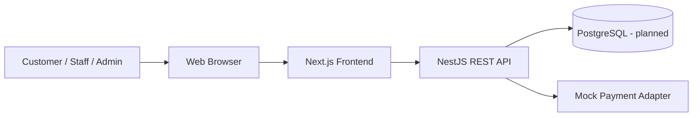
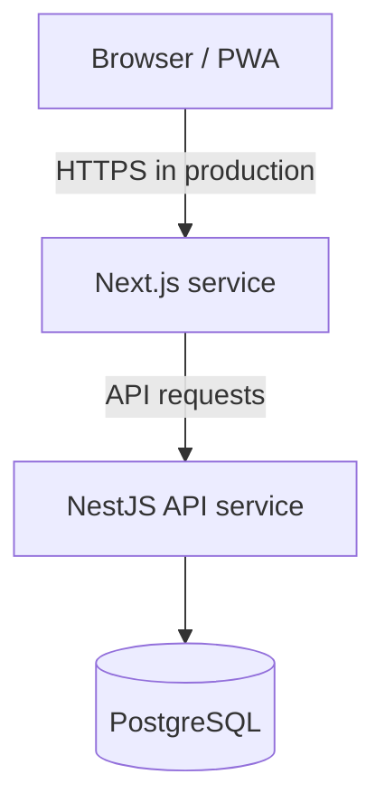

# BrewLite — Software Architecture

> **Status:** Draft for team review. Verify this against the current repository and approved requirements before marking it final.

## 1. Purpose and scope
This document describes the proposed high-level architecture of BrewLite, a cashless coffee-ordering application developed for a Software Engineering course.

## 2. Technology context
The project context identifies:
- **Frontend:** Next.js, React, TypeScript, Tailwind CSS.
- **Backend:** NestJS, TypeScript, REST API.
- **Database:** PostgreSQL is planned for integration.
- **Repository:** Frontend, backend, and docs are maintained in one project repository.
- **Packaging:** Docker is part of the project setup/requirements.

Confirm what is already implemented versus planned by checking the current branch and configuration.

## 3. System context

The browser uses the frontend. The frontend calls the REST API. The backend validates requests, applies business rules, enforces authorization, and accesses persisted data.

**Mock payment** is a proposed logical boundary for a course-project simulation, not evidence of a real payment provider. Do not collect or store card credentials.

## 4. Container view

Production topology, ports, TLS termination, network rules, persistence, and secret delivery must be confirmed with deployment plans. Avoid exposing database ports publicly.

## 5. Backend approach
### Proposed: modular monolith
Keep one NestJS API deployment, organized into cohesive modules. This is a proposal for team confirmation, not a claim about current code layout.

Possible domain boundaries (confirm against requirements):
- **Auth / Identity:** authentication and token/session concerns.
- **Users:** profiles and role-related operations.
- **Catalog / Menu:** products, availability, categories.
- **Orders:** order creation and lifecycle.
- **Payments:** mock payment behavior.
- **Common / Infrastructure:** configuration, validation, logging, exception handling, health checks.

Only include modules required by the agreed scope.

### Request flow
1. Client sends a request to the REST API.
2. API validates input and authenticates/authorizes where required.
3. Controller delegates to application/service logic.
4. Service applies rules and accesses persistence through the selected data layer.
5. API returns a documented response or consistent error.

Keep controllers thin and avoid duplicating business rules in the frontend.

## 6. Data integrity
- PostgreSQL is planned as the relational database.
- Use database constraints as well as server-side validation.
- Use transactions when a business operation updates multiple related records (e.g. an order and its line items).
- ORM/data-access choice is not confirmed here; see [ADR-002](adr/002-orm-selection.md).
- Order status rules need confirmation; see [ADR-003](adr/003-state-machine.md).

## 7. Cross-cutting concerns
### Security
- Validate input on the server.
- Enforce authorization on backend endpoints.
- Use a maintained password-hashing algorithm/library with appropriate parameters.
- Keep secrets in environment/deployment secret configuration, never Git.
- Use HTTPS in production and least-privilege service credentials.
- Do not store card data in mock payment flows.

### Errors and logging
- Return consistent error shapes without leaking stack traces or internals.
- Log operationally useful events; use request/correlation IDs where practical.
- Never log passwords, tokens, or sensitive payment information.

### Health checks and configuration
- Define liveness and, if needed, readiness checks; confirm actual route paths.
- Validate required environment variables at startup.
- Keep local, CI, and production configuration separate.
- Commit placeholder-only `.env.example`, never real secrets.

## 8. Quality attributes and trade-offs
| Concern | Proposed response | Trade-off |
|---|---|---|
| Maintainability | Cohesive modules, thin controllers | Requires discipline to avoid cross-module coupling |
| Simplicity | One backend deployment | Less independent scaling than microservices |
| Security | Server validation, authorization, secret handling | Adds implementation/review effort |
| Integrity | Constraints and targeted transactions | Requires migration and transaction care |
| Testability | Service tests and API integration tests | Needs reliable fixtures and test data |
| Deployability | Docker where configured | Containers alone do not provide production security/monitoring |

## 9. ADR index
- [ADR-001: Monorepo](adr/001-monorepo.md)
- [ADR-002: Data access / ORM selection](adr/002-orm-selection.md)
- [ADR-003: Order state transitions](adr/003-state-machine.md)

## 10. Approval checklist
- [ ] Compare diagram and modules with current repository.
- [ ] Confirm PostgreSQL integration status.
- [ ] Confirm ORM and migration workflow.
- [ ] Confirm order lifecycle and mock-payment behavior.
- [ ] Confirm authentication and authorization model.
- [ ] Confirm health checks, logging, env vars, and Docker setup.
- [ ] Obtain team review and update statuses/ADRs.
