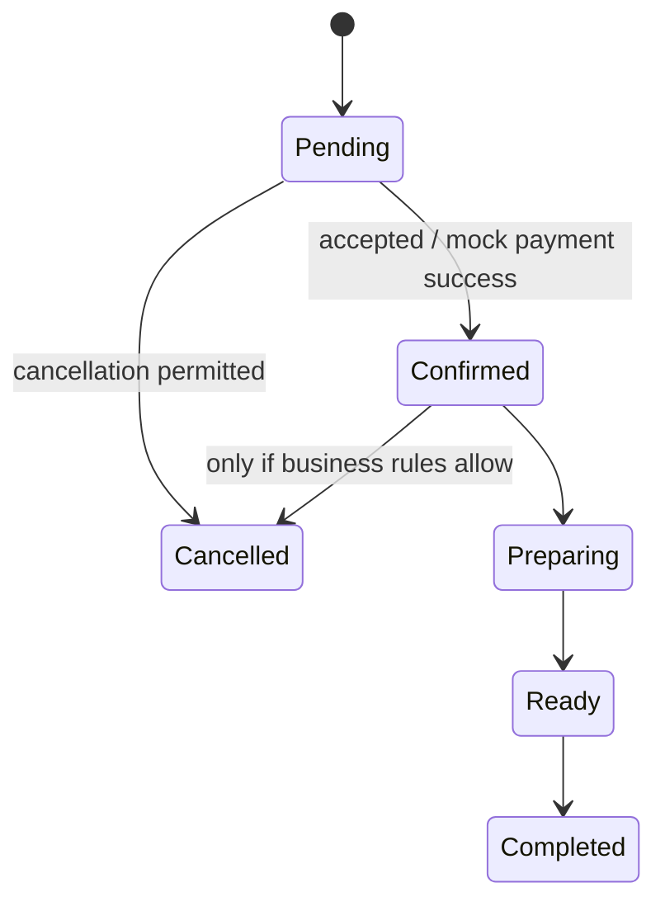

# ADR-003: Explicit order state transitions

- **Status:** Proposed — validate against requirements
- **Date:** 2026-10-23
- **Decision owners:** Project team

## Context
A coffee-ordering workflow needs consistent statuses across backend, frontend, and tests.

## Proposal
Represent the order lifecycle explicitly and enforce valid transitions in backend business logic. Do not accept arbitrary status values directly from clients.

## Illustrative flow — not approved

## Rules to confirm
- Status names and meanings.
- Which actor may trigger each transition.
- Cancellation policy after confirmation/preparation.
- Behavior for duplicate requests and retries.
- Mock-payment success/failure effects.
- Whether transitions require audit events.

## Consequences
**Benefits:** predictable workflow, clearer acceptance tests, prevention of invalid/unauthorized status changes.

**Costs / risks:** requires explicit rules and tests; requirement changes may require coordinated API/UI updates.

## Follow-up
- [ ] Align states and transitions with approved use cases/user stories.
- [ ] Document the API operations that trigger transitions.
- [ ] Test valid, invalid, and unauthorized transitions.
